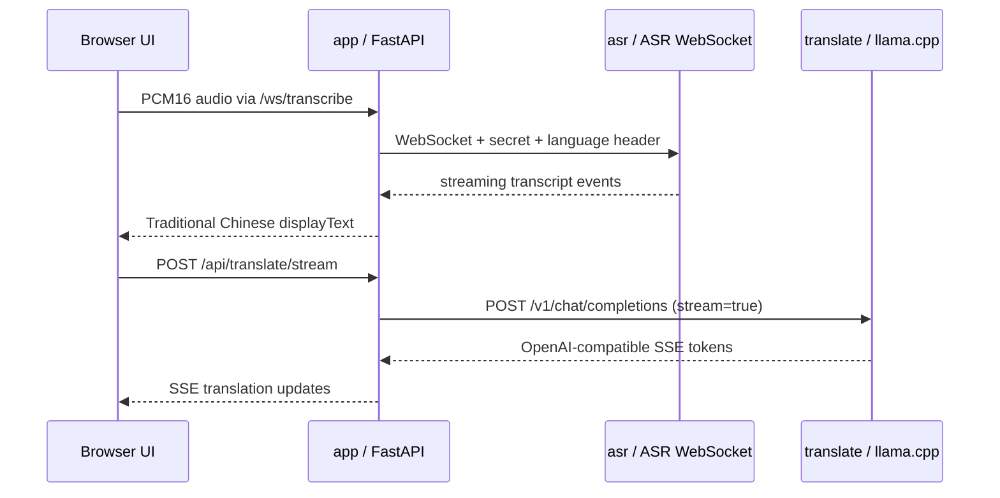

# Yuqiao Live — Real-time Meeting Transcription and Translation

**Language:** [繁體中文](README.md) | English

Yuqiao Live (語橋 Live) is a locally deployed web app for real-time meeting transcription and cross-language translation. Users can capture audio from a microphone, a Chrome tab / system audio, or a mix of both. The left column shows the transcript; the right column first shows a draft translation, then revises it with the full sentence once the sentence is complete. It is designed for one person joining online meetings, watching videos, or attending online classes.

The product UI does not show the underlying model names; this README keeps the model, framework, and deployment details for maintenance, verification, and license checks. Real-time speech recognition uses Confucius4-R2T2 running locally; the text model (translation, Precision mode cleanup, cloud refinement, meeting minutes) currently uses the cloud OpenAI-compatible model `deepseek-v4-flash` (through a litellm gateway). With enough compute, the text model can be replaced with a large on-premises model; see [Text model: cloud or on-premises](#text-model-cloud-or-on-premises).

> The first start needs to download Docker images and the ASR/VAD models (plus the Qwen3-ASR weights when Precision mode is enabled, and the local translation model's weights when using it). After download, the model caches are kept in Docker named volumes. Real-time speech recognition is processed inside the local Docker network; **the current translation text is sent to the configured cloud text model** (the meeting page shows 「雲端翻譯」 (Cloud translation)), and Precision mode, cloud refinement, and Azure MAI also send text or audio to external services. When you switch to an on-premises text model, the text does not leave your network. The first download still connects to model sources such as Hugging Face.

## Features

- Real-time speech transcript, segmented live translation, transcript copy, and text-file export.
- Audio source can be the microphone, a Chrome tab / system audio, or a mix of both; you can pick the input device and press 「測試音源」 (Test audio source) before the meeting to confirm sound is coming in.
- Source and target languages are selectable, and the direction can be swapped, e.g. Japanese→Chinese, Chinese→Japanese, English→Chinese, Chinese→English.
- Chinese–Japanese bidirectional auto mode: detects Chinese or Japanese turn by turn, translates Chinese into Japanese and Japanese into Traditional Chinese, and labels the direction on the translation.
- Meeting mode can choose 「不翻譯（只整理原文）」 (No translation (transcript only)): only the transcript is kept and it takes the full width; combined with Precision mode it instead does a fluency edit (fixes typos, removes filler words, starts a new sentence when the speaker changes).
- Chinese recognition and Chinese translations are displayed in Taiwan Traditional Chinese; the model's original text is converted with OpenCC `s2tw` (characters only, no word substitution). Japanese text is not converted.
- Two columns on desktop; on mobile, Transcript / Translation tabs, a fixed meeting toolbar, and a settings dialog, in both portrait and landscape. Names, brands, or proper nouns can be supplied as Meeting context.
- The top-right corner switches between light and dark themes; the choice is saved in the current browser.
- Fast page switching: once you have viewed any page in a tab, every later page shows its top bar immediately on open (the account is cached in the tab's sessionStorage for display only; permissions are still checked by the server). In Chrome and Edge, hovering over a top-bar link prepares that page in the background, and the data is fetched again when it is shown.
- Local Docker deployment: real-time speech recognition runs locally; the text model used for translation can be a cloud (current) or on-premises model, switched through an OpenAI-compatible API.
- After the meeting: transcript review (including 「修正名詞」 (Fix terms) to correct a term across the whole meeting at once), AI meeting minutes and action item tracking, full-text search, and 「問答」 (Q&A) to ask about meeting content in one sentence (every sentence cites its source). When starting the next meeting, you can 「帶入上次的名詞」 (Bring in last terms).
- 「我的紀錄」 (My records): personal records of Live translation and Live interpretation, which can be turned into a team meeting record in one click with 「轉成會議紀錄」 (Convert to meeting record).
- After the minutes are finalized they are emailed to the team (company SMTP); you can choose to send to members' personal mailboxes or a team group mailbox, and send automatically on finalization or resend manually.

## Technology and Service Architecture

| Layer | Technology | Purpose |
| --- | --- | --- |
| Web UI | Native HTML, CSS, JavaScript, MediaDevices, Web Audio API, AudioWorklet | Audio source selection, mixing, 16 kHz PCM encoding, two-column transcript and translation display |
| Web/API | Python 3.12, FastAPI, Uvicorn, WebSocket | Static pages, audio WebSocket proxy, translation API, OpenCC Traditional Chinese conversion |
| ASR | `qwenllm/qwen3-asr` container + Confucius4-R2T2 | Streaming recognition of 16 kHz mono PCM audio |
| VAD | FireRedVAD Stream-VAD | Model required for voice activity handling on the ASR server side |
| Text model | Current: cloud `deepseek-v4-flash` (litellm gateway, OpenAI-compatible); optional: local Google Gemma 4 E2B-it QAT Q4_0 GGUF + `llama.cpp` CUDA server, or another on-premises large model | Translation, Precision mode cleanup, cloud refinement, and meeting minutes; all called through the OpenAI-compatible Chat Completions API |
| Runtime | Docker Compose, NVIDIA Container Toolkit | Manages containers, GPU, service dependencies, and model caches |

### Deployment Topology

```mermaid
flowchart LR
  browser[Chrome browser<br/>Yuqiao Live UI]
  subgraph docker[Docker Compose / local GPU host]
    app[app<br/>FastAPI + Uvicorn<br/>static pages, WebSocket, translation API]
    asr[asr<br/>Confucius4-R2T2 + VAD<br/>GPU streaming recognition]
    translate[translate (optional)<br/>llama.cpp + Gemma 4<br/>local text translation]
    asrCache[(model-cache<br/>ASR and VAD weights)]
    translateCache[(translation-model-cache<br/>GGUF weights)]
    db[(db<br/>PostgreSQL 17 + pgvector)]
    embed[embed<br/>llama.cpp CPU<br/>bge-m3 embedding]
    embedCache[(embed-model-cache<br/>embedding weights)]
    diarize[diarize<br/>transcribe.cpp CPU<br/>MOSS speaker diarization]
    diarizeCache[(diarize-model-cache<br/>MOSS GGUF)]
  end
  browser <-->|HTTP, WebSocket, SSE<br/>localhost:18082| app
  app <-->|internal WebSocket<br/>asr:8272| asr
  app <-->|internal HTTP<br/>translate:5000| translate
  asrCache --- asr
  translateCache --- translate
  app <-->|internal SQL<br/>db:5432| db
  app -->|internal HTTP<br/>embed:5001| embed
  embedCache --- embed
  app -->|internal HTTP<br/>diarize:5002| diarize
  diarizeCache --- diarize
```

Compose defines five services that start by default — `app`, `asr`, `db`, `embed`, `diarize` — plus services enabled by profile: the local translation model `translate` (`local-translate`), `qwen-asr` for Precision mode, `dev-ldap` for development, the local test mailbox `dev-mail`, and the Cloudflare Tunnel `tunnel` for public access. For running the translation model locally or as an external service, see [Where to put the translation model](#where-to-put-the-translation-model). The only ports published to the host are `app`'s `18082`, plus `qwen-asr`'s `18000` when started with its profile (for other systems on the LAN; see [Serving Qwen3-ASR to other systems](#serving-qwen3-asr-to-other-systems)) and the development `dev-mail`'s `18025` (bound to 127.0.0.1 only); all other services are reachable only on the Compose internal network. Named volumes keep the downloaded weights and the database. On startup `app` waits for the `asr` and `db` health checks to pass (whether the translation model is ready is shown in the service status on the meeting page); `embed` is not required — without it, 「問答」 (Q&A) uses keyword search only; `diarize` is not required either — without it, segments are not labeled with speakers.

### Where Docker Images and Model Weights Are Downloaded

A Docker image is the "runtime environment"; model weights are the "model files" loaded when a service starts. The two are downloaded and stored separately:

| Compose service | Docker image / build method | How model weights are obtained | Where it is defined |
| --- | --- | --- | --- |
| `asr` | [`qwenllm/qwen3-asr:latest`](https://hub.docker.com/r/qwenllm/qwen3-asr), the ASR runtime downloaded from Docker Hub | When the ASR server starts it loads `netease-youdao/Confucius4-R2T2` from Hugging Face; the entrypoint also uses `hf download` to fetch the Stream-VAD from `FireRedTeam/FireRedVAD` | `asr.image` in [`compose.yaml`](compose.yaml); [`docker/asr/entrypoint.sh`](docker/asr/entrypoint.sh) |
| `translate` | [`ghcr.io/ggml-org/llama.cpp:server-cuda`](https://github.com/ggml-org/llama.cpp/pkgs/container/llama.cpp), the llama.cpp server with CUDA downloaded from GitHub Container Registry | On startup llama.cpp downloads the Gemma GGUF from Hugging Face according to `--hf-repo` and `--hf-file` | `translate.image` and `command` in [`compose.yaml`](compose.yaml) |
| `db` | [`pgvector/pgvector:0.8.7-pg17-trixie`](https://hub.docker.com/r/pgvector/pgvector): PostgreSQL 17 plus pgvector; like the previous `postgres:17` it is Debian trixie, so the existing data directory can be reused as is | No model needed; data lives in the `meeting-db` volume | `db` in [`compose.yaml`](compose.yaml) |
| `embed` | [`ghcr.io/ggml-org/llama.cpp:server`](https://github.com/ggml-org/llama.cpp/pkgs/container/llama.cpp) (CPU build) | Downloads the embedding GGUF from Hugging Face according to `EMBED_MODEL_REPO` and `EMBED_MODEL_FILE` (default `ggml-org/bge-m3-Q8_0-GGUF`, about 600 MB) | `embed` in [`compose.yaml`](compose.yaml) |
| `diarize` | Built locally: [`docker/diarize/Dockerfile`](docker/diarize/Dockerfile) compiles a pinned version of [transcribe.cpp](https://github.com/handy-computer/transcribe.cpp) (copying only the statically linked `transcribe-cli`), plus a small HTTP service written with the Python standard library | On first start downloads the Q8_0 of `handy-computer/MOSS-Transcribe-Diarize-gguf` from Hugging Face (about 1 GB, Apache-2.0) into `diarize-model-cache` | `diarize` in [`compose.yaml`](compose.yaml) |
| `app` | No prebuilt project image; Compose builds it locally with `build: ./webapp`. [`webapp/Dockerfile`](webapp/Dockerfile) is based on `python:3.12-slim` and installs `webapp/requirements.txt` | Does not download or store ASR / translation models; runs FastAPI and the static web UI | `app.build` in [`compose.yaml`](compose.yaml), [`webapp/Dockerfile`](webapp/Dockerfile) |

Model cache locations are also separate: ASR and VAD share `model-cache`, mounted at `/models` in the ASR container, with the Hugging Face cache directory at `/models/huggingface`; the Gemma weights use `translation-model-cache`, mounted at `/root/.cache` in the translation container; the embedding weights use `embed-model-cache`. So the models are kept after a normal `docker compose down`. ⚠️ `docker compose down -v` deletes **all** named volumes, including the meeting database `meeting-db` (accounts, teams, meetings, review edits, minutes, action items, member photos). Do not use it to clear model caches; see [Verification and routine maintenance](#verification-and-routine-maintenance) for how to do it.

Startup order is managed by Compose: `docker compose --profile local-translate up --build -d` first prepares / downloads the images, starts `asr` and `translate`, and starts `app` only after the `asr` health check succeeds. The ASR, VAD, and Gemma weights are downloaded or loaded the first time each container starts; later restarts use the cache. See [`compose.yaml`](compose.yaml) for the full image, GPU, command, environment variable, volume, and health check settings.

### Model Serving and Code Integration Points



- **ASR startup:** [`docker/asr/entrypoint.sh`](docker/asr/entrypoint.sh) installs the project and the Hugging Face CLI, checks for and downloads Stream-VAD, and finally runs [`ws_server.py`](ws_server.py), passing `ASR_MODEL_PATH` and `VAD_MODEL_PATH`. The ASR image, environment variables, mount paths, and health check are in the `asr` block of [`compose.yaml`](compose.yaml).
- **Gemma startup:** `translate.command` in `compose.yaml` starts the llama.cpp server; `--hf-repo` and `--hf-file` specify the weights, and `--port 5000` serves on the Compose internal network. Gemma's GPU offload, context, parallel, and model cache settings are all in the same `translate` block.
- **Audio to ASR:** [`webapp/static/app.js`](webapp/static/app.js) converts browser audio to PCM16 and connects to `/ws/transcribe`; `transcribe()` in [`webapp/server.py`](webapp/server.py) reads the browser WebSocket and connects to the ASR container through `ASR_WS_URL` (set by Compose to `ws://asr:8272/asr_stream_api_v1`), relaying audio and recognition events. FastAPI adds `ASR_SECRET_KEY` and the language settings, and uses OpenCC to produce Traditional Chinese display text.
- **Transcript to translation:** `runTranslation()` in `app.js` calls `/api/translate/stream`; `translate_stream()` and `translation_payload()` in `server.py` use `httpx` to call `/v1/chat/completions` on `TRANSLATE_URL` (set by Compose to `http://translate:5000`) and relay the SSE chunk by chunk. The model weight file name comes from `TRANSLATE_MODEL`.
- **Web UI startup:** [`webapp/Dockerfile`](webapp/Dockerfile) builds the Python/FastAPI app image. Compose mounts the local `./webapp` into the container at `/app`; Uvicorn starts with `app` from `webapp/server.py` and serves the static pages. The host browser uses `http://localhost:18082` and never connects to ASR or llama.cpp directly.

### Meeting Data Flow

```mermaid
flowchart TD
  mic[Microphone<br/>getUserMedia] --> mix[Browser AudioContext<br/>mixing and AudioWorklet]
  tab[Chrome tab / system audio<br/>getDisplayMedia] --> mix
  mix --> pcm[Resample to 16 kHz<br/>mono PCM16]
  pcm -->|binary audio<br/>WS /ws/transcribe| gateway[FastAPI WebSocket proxy]
  gateway -->|internal WebSocket| asr[Confucius4-R2T2<br/>streaming ASR]
  asr -->|recognition deltas| gateway
  gateway -->|OpenCC s2tw<br/>Chinese to Taiwan Traditional| transcript[Browser left column<br/>live transcript]
  transcript --> scheduler[Front-end segment scheduler<br/>phrase drafts / revise at sentence end or pause]
  scheduler -->|POST /api/translate/stream| api[FastAPI translation proxy]
  api -->|Chat Completions<br/>stream=true| llm[Text model<br/>cloud or on-premises (OpenAI-compatible)]
  llm -->|token stream| api
  api -->|SSE accumulated translation<br/>Chinese to Traditional| scheduler
  scheduler -->|update only when each round completes<br/>keep previous translation| translation[Browser right column<br/>drafts and final]
  transcript --> export[Copy / export text]
  translation --> export
```

1. The browser obtains audio with the user's permission; mixed mode combines the two audio streams. The AudioWorklet samples the audio, the front end converts it to 16 kHz mono PCM16, and sends it over `/ws/transcribe`. When sharing a screen only the audio track is read; video never enters this data flow.
2. FastAPI opens an internal WebSocket to ASR, adds the service secret and language settings, and sends recognition deltas back to the browser. Chinese display text is converted to Taiwan Traditional Chinese on the server with OpenCC `s2tw` (characters only, no word substitution, so that `s2twp` does not turn ordinary words into IT terminology); the original recognized text is not rewritten.
3. The front end requests draft translations of newly added phrases at a fixed rhythm; at sentence-ending punctuation, a pause of about 1.8 seconds, an overly long segment, or when the meeting ends, it requests a full-sentence revision. The translation proxy calls llama.cpp with an OpenAI-compatible request and wraps the model token stream as SSE.
4. The front end accumulates each round of SSE and replaces the draft in the right column in place only when the round is complete; during revision the previous version is kept, and the screen is not rebuilt token by token. It auto-scrolls only if the user was already near the bottom of the right column. Copy and export use the transcript and translation visible at that moment.

### Key Files

| Path | Responsibility |
| --- | --- |
| [`compose.yaml`](compose.yaml) | All services (including those enabled by a profile), GPU, health checks, ports, and model cache volumes |
| [`docker/asr/entrypoint.sh`](docker/asr/entrypoint.sh) | Prepares the VAD weights and starts streaming ASR |
| [`ws_server.py`](ws_server.py), [`r2t2/`](r2t2), [`pyproject.toml`](pyproject.toml) | ASR WebSocket service, recognition model interface, and in-container install settings; reused and adapted from the upstream project |
| [`webapp/server.py`](webapp/server.py) | FastAPI routes, ASR WebSocket proxy, translation API, and Traditional Chinese conversion |
| [`webapp/static/app.js`](webapp/static/app.js) | Audio capture, PCM streaming, translation segment scheduling, and UI state |
| [`webapp/static/pcm-worklet.js`](webapp/static/pcm-worklet.js) | Browser audio sampling processor |
| [`webapp/static/index.html`](webapp/static/index.html) and CSS | Yuqiao Live interface, light/dark themes, and two-column layout |
| [`webapp/test_server.py`](webapp/test_server.py), [`smoke_test.py`](smoke_test.py) | API / proxy unit tests and a real WebSocket audio smoke test |

### Project Scope and Upstream Source

This repo keeps only the files needed to run, deploy, and test Yuqiao Live. On the ASR side, `ws_server.py`, `r2t2/`, and `pyproject.toml` come from and are adapted from [Netease Youdao's original Confucius4-R2T2 project](https://github.com/netease-youdao/Confucius4-R2T2); the source code license is kept in [`LICENSE`](LICENSE). Unused upstream examples, `r2t2_llama/`, test resources, and large binaries are not included here; see the upstream project for them. `r2t2_llama/` is an optional upstream ASR backend; this project's Gemma translation is provided separately by the llama.cpp Docker image, so do not confuse the two.

Neither the ASR nor the translation model weights are uploaded to this repo; each container downloads its own at deployment. Before using the models, please also review the [Confucius4-R2T2 model card](https://huggingface.co/netease-youdao/Confucius4-R2T2) and the [upstream model license](https://github.com/netease-youdao/Confucius4-R2T2/blob/master/MODEL_LICENSE).

## Models and Language Coverage

### Confucius4-R2T2: Speech Recognition

Uses [Netease Youdao's Confucius4-R2T2](https://huggingface.co/netease-youdao/Confucius4-R2T2), built on the Qwen3-ASR architecture and optimized for real-time Chinese and English recognition. The model card also lists Japanese, Korean, French, German, Italian, Portuguese, Russian, Spanish, Arabic, and other languages. The vendor does not provide an equal quality guarantee for every language / direction combination listed in this project's UI.

The web page also offers Cantonese, Indonesian, Thai, Vietnamese, Turkish, Hindi, Malay, Dutch, Swedish, Danish, Finnish, Polish, Czech, Filipino, Persian, Greek, Romanian, Hungarian, and Macedonian, marked as experimental. These are language hints the current ASR service interface accepts; this does not mean Confucius4-R2T2 or this project has validated recognition quality for them.

The source menu's 「中英自動偵測」 (Chinese–English auto-detect) covers the Chinese/English scenarios this product is mainly optimized for; for other languages, specify the source explicitly. The translation model menu uses the same language list, but Gemma 4's "35+ languages supported out of the box" does not mean every menu language and direction has been quality-validated by this project. Low-resource languages, mixed-language sentences, proper nouns, and very short fragments in particular should be checked against real meeting content.

### Text Model: Cloud or On-Premises

Translation, Precision mode cleanup and look-back revision, cloud refinement, and meeting minutes are all handled by one OpenAI-compatible text model, specified with `TRANSLATE_URL`, `TRANSLATE_MODEL`, `TRANSLATE_KEY` (and `TRANSLATE_QUALITY_*`, `TRANSLATE_REFINE_*`, `MINUTES_*`) in `.env`. Switching models requires no code changes.

- **Current setup**: cloud `deepseek-v4-flash`, through a local litellm gateway (`TRANSLATE_URL=http://host.docker.internal:4001`). It does not use this host's GPU, leaving the GPU for real-time recognition and Precision mode's Qwen3-ASR; the trade-off is that each meeting's text is sent to that cloud service.
- **Use an on-premises large model when you have the compute**: on another (or the same) machine with enough GPU, serve a large model with an OpenAI-compatible API using vLLM, llama.cpp, or similar, then point `TRANSLATE_URL` and `TRANSLATE_MODEL` at it (change the other `*_URL` / `*_MODEL` too), and the text never leaves your network. Translation and Precision mode quality depend mainly on the text model's capability (for evaluations see [Quality improvement log](#quality-improvement-log-2026-11)), so choose a strong enough model and compare with `bench/` first. Note: whether the page shows 「雲端翻譯」 (Cloud translation) depends only on whether `TRANSLATE_KEY` has a value; if your on-premises service needs no key, leave it empty, otherwise the label will say cloud.
- **Smallest local option**: `--profile local-translate` starts the Gemma 4 E2B below (about 3.35 GB of weights), which handles translation only; on a 32 GB GPU it and Qwen3-ASR are mutually exclusive (see [Where to put the translation model](#where-to-put-the-translation-model)).

### Optional: Local Gemma 4 E2B-it QAT Q4_0

Uses `gemma-4-E2B_q4_0-it.gguf` from Google's [Gemma 4 E2B-it quantized GGUF repo](https://huggingface.co/google/gemma-4-E2B-it-qat-q4_0-gguf), an instruction-tuned text generation model quantized with QAT Q4_0. The GGUF weights are about **3.35 GB**; the whole repo is about **4.34 GB**, including a multimodal projector of about 987 MB. This project only does text translation, so `--no-mmproj` skips loading the projector. Actual GPU usage also includes the CUDA runtime, KV cache, context, and ASR, so it is not just the weight file size.

In this project Gemma 4 handles **text translation after transcription**; speech recognition is handled by Confucius4-R2T2. The model receives the source / target languages, the current sentence, and a small amount of recent translation context, and is asked to return only the translation. Short fragments usually come back faster; full-sentence translation quality and latency depend on the GPU, ASR segmentation timing, and sentence length. E2B Q4 was chosen to reduce resource usage and waiting for a single-person meeting; for higher translation quality you can switch to a larger model, but it needs more VRAM and latency may increase.

## How Gemma 4 Is Served

This project starts Gemma with the [`llama.cpp` CUDA server image](https://github.com/ggml-org/llama.cpp/blob/master/tools/server/README.md). The main settings are in the `translate` service of [`compose.yaml`](compose.yaml):

```yaml
image: ghcr.io/ggml-org/llama.cpp:server-cuda
gpus: all
command:
  - --hf-repo
  - google/gemma-4-E2B-it-qat-q4_0-gguf
  - --hf-file
  - gemma-4-E2B_q4_0-it.gguf
  - --host
  - 0.0.0.0
  - --port
  - "5000"
  - --n-gpu-layers
  - "99"
  - --ctx-size
  - "3072"
  - --parallel
  - "1"
  - --flash-attn
  - on
  - --no-mmproj
  - --reasoning
  - "off"
  - --no-webui
volumes:
  - translation-model-cache:/root/.cache
```

On the first Compose start, llama.cpp downloads the specified repo and GGUF from Hugging Face into `translation-model-cache`, then loads it on the GPU. `--hf-file` explicitly selects the Q4_0 weight file so a different quantization is not picked automatically; `--n-gpu-layers 99` tries to offload the model layers to the GPU; `--ctx-size 3072` and `--parallel 1` configure the service for a single meeting / single request; `--no-mmproj` skips the unneeded multimodal projector; `--reasoning off` prevents extra reasoning text before the translation. Compose includes the translation service's health check in the app's startup dependencies.

Compose exposes the current defaults as environment variables, so you can specify a different repo or file in `.env`:

```dotenv
TRANSLATE_MODEL_REPO=google/gemma-4-E2B-it-qat-q4_0-gguf
TRANSLATE_MODEL_FILE=gemma-4-E2B_q4_0-it.gguf
```

To start llama.cpp on its own (without Compose), the equivalent basic command is below; to use the same CUDA image, the GPU, and a persistent model cache, use the Docker version:

```bash
docker run --rm --gpus all -p 5000:5000 \
  -v gemma4-cache:/root/.cache \
  ghcr.io/ggml-org/llama.cpp:server-cuda \
  --hf-repo google/gemma-4-E2B-it-qat-q4_0-gguf \
  --hf-file gemma-4-E2B_q4_0-it.gguf \
  --host 0.0.0.0 --port 5000 \
  --n-gpu-layers 99 --ctx-size 3072 --parallel 1 \
  --flash-attn on --no-mmproj --reasoning off --no-webui
```

llama.cpp provides the OpenAI-compatible `POST /v1/chat/completions`. This project's FastAPI service calls it with `TRANSLATE_URL=http://translate:5000`; the UI never connects to the model service directly.

## System Requirements

- Windows 11/WSL2 or Linux, Docker Desktop / Docker Engine, and Docker Compose v2.
- An NVIDIA GPU, plus Docker/NVIDIA Container Toolkit with the GPU container runtime configured. Compose uses `gpus: all`; ASR and Gemma share the visible GPU.
- Enough VRAM and system memory. `GPU_MEMORY_UTILIZATION=0.40` in `.env.example` is the fraction of GPU memory allocated to ASR's vLLM, not GB reserved for the whole GPU; the translation service uses additional VRAM. The first model download needs access to the Docker registry and Hugging Face, and several GB of disk space.
- When using the microphone or system audio, the latest Chrome is recommended. Browser audio capture requires a secure origin such as `localhost` or HTTPS, and the user must select and authorize it in the browser's share dialog.

## Quick Start

In the project root, using PowerShell:

```powershell
Copy-Item .env.example .env
```

First change `ASR_SECRET_KEY` in `.env` to a long random string you generate yourself, then start the services:

```powershell
# Current lineup: translation uses the cloud (or on-premises) text model pointed to by TRANSLATE_* in .env; Precision mode's Chinese recognition uses local Qwen3-ASR
docker compose --profile qwen-asr up --build -d
# Or: run the translation model locally (Gemma 4 E2B, leave TRANSLATE_KEY unset; mutually exclusive with qwen-asr)
# docker compose --profile local-translate up --build -d
docker compose ps
docker compose logs -f asr app
```

The first run downloads the program images, the ASR weights, FireRedVAD Stream-VAD, and the weights for the chosen profile (Qwen3-ASR or Gemma GGUF). Wait for the `asr` (and `qwen-asr` or `translate`) healthcheck to pass, then open [http://localhost:18082](http://localhost:18082). If you changed `APP_PORT` in `.env`, use that port instead. Press `Ctrl+C` to stop following the logs; the services keep running in the background.

## Login and Teams

Yuqiao Live is shared by multiple teams: everyone logs in with their company LDAP account, each meeting belongs to one team, and **teams cannot see each other's meeting records**.

1. In `.env`, set `POSTGRES_PASSWORD` (a long random string), `ADMIN_USERS` (LDAP accounts of system administrators, comma-separated), and `LDAP_*` (see [Configuration reference](#configuration-reference)).
2. `docker compose up -d db app`; the app creates or upgrades the tables automatically on startup.
3. Verify the LDAP settings first (the password is entered without being shown):
   ```powershell
   docker exec -it asr_confucius4-r2t2-app-1 python -m auth check-ldap <帳號>
   ```
4. After logging in, a system administrator creates teams and adds members from 「團隊管理」 (Team management, `/admin`) in the page header. Members can be added by account before they log in for the first time. Click a member's avatar to set or change their photo (PNG, JPEG, WebP): after choosing an image a crop dialog opens where you can drag and resize a square frame to select the area and see a circular preview; 「確定」 (OK) shrinks it to 160×160 and uploads it, 「取消」 (Cancel) or Esc changes nothing, and when a photo exists there is 「移除照片」 (Remove photo) next to it. Everyone can also click their own avatar in the header to change or remove their photo from the menu. Team management, the header, and the action item board show the photos; without a photo, the first character of the name is shown.
5. A regular user, after logging in, selects the team this meeting belongs to in the 「團隊」 (Team) menu before starting. An account with no team cannot start a meeting.

Permission rules:
- All pages, APIs, and the transcription WebSocket require login (except `/api/health`); a login lasts 12 hours, and you can log out at any time.
- 5 wrong passwords for the same account within 5 minutes locks it for 5 minutes.
- Team members can view, listen to, and edit their own team's meetings; system administrators have **no** implicit access and must be a member of the team to see it. Removal from a team takes effect immediately.
- Pages on other websites cannot borrow the logged-in cookie to call the API or start recording.
- Meeting files are stored in `output/teams/<團隊 id>/<會議 id>/` (team id / meeting id); old files stored in the `output/` root before this feature existed are left as is and are not served through the web.

**When the company LDAP is unreachable (development and testing)**: compose has a development-only OpenLDAP (profile `dev-ldap`, no published port) with test accounts `myyang`, `alice`, and `bob`, whose passwords are `yq-test-<帳號>` (`<帳號>` = account; see [docker/dev-ldap/users.ldif](docker/dev-ldap/users.ldif)):

```powershell
docker compose --profile dev-ldap up -d dev-ldap
```

Matching `.env` settings: `LDAP_URL=ldap://dev-ldap:389`, `LDAP_TLS=none` (the test directory is only on the Compose internal network and is connected in plaintext; the app logs a warning on startup), `LDAP_BASE_DN=ou=people,dc=yuqiao,dc=test`, `LDAP_BIND_DN=cn=admin,dc=yuqiao,dc=test`, `LDAP_BIND_PASSWORD` the same as `DEV_LDAP_ADMIN_PASSWORD`, `LDAP_USER_FILTER=(uid={username})`. When switching to the company LDAP, replace these lines and run `docker compose up -d app`, then `docker compose --profile dev-ldap rm -sfv dev-ldap` to remove the test directory. Do not start this profile in production.

**Scripts and benchmarks**: replay, smoke test, and similar scripts do not hold passwords; they use a session issued inside the container instead:

```powershell
$env:YUQIAO_SESSION = docker exec -w /app asr_confucius4-r2t2-app-1 python -m auth issue-session <帳號> --hours 12
$env:YUQIAO_TEAM = "研發部"   # can be omitted when the account belongs to only one team
```

## Using It in a Meeting

When opened on a phone over the HTTPS URL, the translation reading area is shown by default; use the 「逐字稿／翻譯」 (Transcript / Translation) tabs to switch content. Languages are selected at the top; the Start/End, Clear, and Export buttons at the bottom stay visible, and long text scrolls only within the reading area. 「設定」 (Settings) opens a dialog for the audio source, microphone test, and Meeting context; system-audio capture options the browser does not support are disabled. Phones work in both portrait and landscape; desktop keeps the two-column layout.

When no meeting is running, the status in the top-right corner shows whether the services are ready: when local speech recognition, translation, and the database are all healthy it shows a lit dot and 「服務就緒」 (Services ready); when any of them does not respond it turns red, for example 「翻譯服務未啟動」 (Translation service not running) (check that the corresponding Docker service is up; it also shows as not running temporarily while the translation model is loading). While the page is open it checks every 30 seconds, and immediately when you switch back to the tab; during a meeting or Live translation it shows 「即時轉錄中／即時翻譯中」 (Transcribing live / Translating live) instead. Cloud MAI and cloud refinement are not covered by this check.

The default 「中日雙向自動」 (Chinese–Japanese bidirectional auto) suits Chinese and Japanese speakers taking turns; the target language is locked to 「中文 ⇄ 日文」 (Chinese ⇄ Japanese). In this mode the ASR detects the language automatically, ending the current turn and resetting the language state when the VAD detects a pause. Recognition results carry language information, and the proxy prefers the Chinese / Japanese tag; when the tag is missing or is another language, kana / kanji and the turn's language are used as a fallback. Translation automatically picks the opposite language for each source segment, keeping draft translations and end-of-sentence revisions, and content from different turns is handled separately. Japanese source text is not converted to Traditional Chinese; Chinese translations are converted to Taiwan Traditional with OpenCC. Leave a short pause when the speaker or language changes; simultaneous speech, mixed languages within a sentence, and short all-kanji sentences without a reliable language tag may still be misjudged.

1. Choose 「語音語言」 (Speech language) and 「翻譯成」 (Translate to); if you know the source language, choose it explicitly. The swap button quickly switches between Chinese/English or Japanese/Chinese directions. If you only want a transcript and no translation, choose 「不翻譯（只整理原文）」 (No translation (transcript only)) under 「翻譯成」 (see [No translation](#no-translation-transcript-only)). Meeting mode remembers these two choices.
2. Choose the audio source:
   - **Microphone**: choose the device below, e.g. a USB microphone or MDR headset microphone; press 「測試音源」 (Test audio source) first and speak to confirm the level meter moves.
   - **Tab / system audio**: after starting, Chrome opens the share picker. When playing YouTube, choose the video tab and tick 「分享分頁音訊」 (Share tab audio); for desktop meetings you can choose a screen and tick the system audio option Chrome provides.
   - **Microphone + system audio**: records both the computer's audio and your own speech. Headphones are recommended to avoid speaker feedback.
3. In 「會議情境」 (Meeting context) you can enter participant names, companies, products, or specialized vocabulary (up to 1000 characters) to help the ASR recognize proper nouns. When a series is selected, or the title exactly matches an earlier meeting of the same team, 「帶入上次的名詞（N 個）」 (Bring in last terms (N)) appears below: it takes the terms from the 5 most recent ended meetings of the same series (or the same title when there is no series), merged newest to oldest, up to 30 terms and 1000 characters; they are added only when you press it, and existing input is kept — only terms not already present are appended.
4. Press 「測試音源」 (Test audio source) to confirm the signal, then press 「開始會議」 (Start meeting). The test result is shown inside the 「測試音源」 button (visible for all three sources; with tab / system audio the button widens to take the microphone field's place): when sound is received it shows 「訊號正常：<音源名稱>」 (Signal OK: <source name>) and a level meter that moves with the volume; if no sound is received within 5 seconds of starting the test, it shows 「還沒收到聲音」 (No sound received yet) in red with a suggestion — for the microphone, 「請對麥克風說話，或換一個麥克風來源」 (Speak into the microphone, or switch to another microphone source); for tab / system audio and mixed, 「請確認分享時勾選了分享音訊，且正在播放」 (Make sure you ticked share audio when sharing, and that something is playing) — and as soon as sound arrives it switches back to 「訊號正常」 (Signal OK). After sharing a tab, when Chrome switches to the shared tab, the Yuqiao page keeps checking in the background. While you speak, the left column shows the transcript and the right column first shows 「暫譯」 (draft translation) in a light-colored block; at sentence-ending punctuation, a pause of about 1.8 seconds, or when the meeting ends, it is revised with the complete sentence and fixed above. Drafts may change; the bottom buttons copy or export the currently visible text.

### Live Translation Mode (No Meeting)

The top of the settings area switches between 「開會／即時翻譯」 (Meeting / Live translation) (the choice is remembered in the browser). Live translation is for two-person conversations or for watching YouTube or videos: the team, title, and series fields are hidden, you just press 「開始翻譯」 (Start translating), and you do not need to belong to any team. **No team meeting record is created**: it does not appear in the meeting record list and cannot be reviewed, searched, or used for Q&A. Each session is saved on end as a 「我的紀錄」 (My records) entry visible only to you (recording, transcript, translation, and per-sentence data; see [Live interpretation and My records](#live-interpretation-and-my-records)), which can later be turned into a team meeting record with 「轉成會議紀錄」 (Convert to meeting record); after ending you can also press 「匯出」 (Export) to download it (file name starts with `translate-`). When connecting, the browser tells the server `mode: "translate"`; the server does not write the meeting's `audio.wav`, and without Precision mode recognition events do not carry `audioMs`.

Live translation mode uses shorter translation segments than Meeting mode: for continuous Chinese speech, once about 40 characters have accumulated it finalizes at a stable comma (16–60 characters per segment), so subtitles can show a complete segment in one or two lines; Meeting mode keeps the original 100-character rule and is unaffected.

### No Translation (Transcript Only)

The first option under 「翻譯成」 (Translate to) in Meeting mode is 「不翻譯（只整理原文）」 (No translation (transcript only)) (Live translation and Live interpretation modes do not have this option and switch back to English when you change to them; when Chinese–Japanese bidirectional is selected, 「翻譯成」 stays disabled as before).

- **Display**: the translation column is hidden and the transcript takes the full width; the start button's caption is 「即時轉錄，不翻譯」 (Live transcription, no translation). Floating subtitles and Screen + subtitles use the source text as the main text.
- **No translation requests**: translation, automatic term learning, and cloud refinement are not called (`/api/translate`, `/api/translate/stream`, `/api/terms`), and the cloud refinement option is hidden.
- **Saving**: each segment's translation is an empty string, and the meeting's target language is recorded as `none`. The meeting page has only the source column, no 「重譯」 (Retranslate), and the edit button is 「儲存」 (Save). A saved meeting cannot later be changed to no-translation, nor can translation be added afterwards.
- **With Precision mode = fluency edit**: every chunk and look-back revision use the meeting-record editing style — fix recognition errors and typos, use Taiwanese written wording, and remove meaningless filler words (嗯、呃、欸、那個、就是、然後、的話、對對對 — "um", "uh", "eh", "that", "like", "then", "if…", "right right right"), stutters, and false starts; but all points that were said are kept (facts, numbers, names, negations, conditions, hedging, questions). Nothing is summarized or added, foreign-language text is kept as is, and unfinished sentences are not completed for the speaker. Example: 「那個我們就是下週要把代辦事項整理一下」→「我們下週要把待辦事項整理一下。」 ("Um, we like need to sort out the to-do items next week" → "We need to sort out the action items next week."; the homophone typo 代辦 is corrected to 待辦). Content words are changed only when the pronunciation is similar and the context or another recognition result supports the change; 「然後、就是、的話」 ("then", "that is", "if") are kept when they carry sequence, condition, or definition meaning. A change of speaker (question, answer, agreement) starts a new sentence, and look-back revision does not merge different people's words.
- **Missing-sentence check** (only with no translation): the source text sent to the model and the answer are compared in order character by character; when a run of 8 consecutive letters or digits in the source (6 words for English and similar languages) cannot be found in the answer, the missing part is pointed out and the question is asked once more, and the answer with less missing content is used. Content that merely moved, was repeated, or was a false start does not count as missing. When a look-back revision drops a sentence, the original is kept. The log records only how many characters were missing, not the content. Each chunk also includes the notes accumulated by look-back revision (people, names, terms) to help get names right.
- Precision mode also drops sentences that only repeat the end of the previous sentence (at least 6 characters); this applies in translation modes too.

Traditional conversion of 「只／隻」 ("only" / measure word): when the 「隻」 produced by OpenCC is directly followed by 有、是、要、能、會、好、在、不、得, it is changed back to 「只」 (e.g. 「不是只有」, "not only"); it is left unchanged when the source already wrote 「隻」 or when it is preceded by a number or quantifier usage such as 幾、每、這、那 (e.g. 「只有一只」→「只有一隻」, "only one [animal]"). This applies to all modes.

### Floating Subtitles

「浮動字幕」 (Floating subtitles) in the footer opens a small **always-on-top** window (Document Picture-in-Picture in Chrome / Edge 116 and later) that shows the most recent finalized segments from bottom up (in Meeting mode, the most recent sentences, up to 30 segments; as many as fit the window height, newest at the bottom, older ones fading), ending with the draft translation in warm yellow. It can be dragged anywhere on screen and resized, and stays visible when you switch to the video tab or go full screen. Inside the window you can toggle the source text (each translation segment shows its source above it, plus the sentence currently being spoken), with source and translation at the same font size; A−/A+ adjusts among four font sizes (22/28/34/40px), and the setting is remembered in the browser. The browser cannot overlay subtitles transparently on other windows, so this window itself is opaque and covers that small area of the screen beneath it. Firefox, Safari, and mobile lack this API, so the button is disabled with an explanation. Works in both Meeting and Live translation modes.

### Screen + Subtitles

For **truly semi-transparent** subtitles overlaid on video, use 「畫面＋字幕」 (Screen + subtitles) in the footer: when the audio source is 「分頁／系統聲音」 (Tab / system audio) or 「麥克風＋系統聲音」 (Microphone + system audio), Chrome hands over the video of the tab you chose to share along with it, and this feature shows it enlarged on this site's page (press 「全螢幕」 (Full screen) for full screen), with a subtitle box overlaid on a semi-transparent background — the 「背景」 (Background) slider adjusts the background opacity (20–100%, background only; text is unchanged). The subtitle box can be dragged anywhere; its position, opacity, and source-text toggle are remembered in the browser (source text is shown by default); the font size is shared with Floating subtitles. The subtitle box has a fixed height and does not grow or shrink with content: 2 lines of source and 3 lines of translation (the most recent finalized segments, with the draft appended at the end; 2 fewer lines when source text is turned off), all at the same font size and weight; short content starts from the top, and when it exceeds the line count the newest text is shown; in shorter windows the font size shrinks and the box never exceeds half the window height. The source text currently being spoken and its draft translation share the same warm yellow, while finalized source and translation are white, so you can see at a glance which translation segment corresponds to what is being said now (the Floating subtitles window does the same). Esc or ✕ closes it. The video is only displayed locally — it is not recorded or uploaded; the sound still plays from the original tab. A microphone-only source has no video, so the button is disabled with an explanation; it closes automatically when the session ends. The reason the Floating subtitles window is not simply made transparent is that Chrome's Document Picture-in-Picture windows are always opaque.

How the subtitles move (shared by Floating subtitles and Screen + subtitles): when new text makes already-displayed segments change position, the segments slide over with an animation of about a quarter second instead of the whole line jumping instantly; a newly finalized segment appears where its draft was; the 「正在講」 ("currently speaking") source text is shown in full within one to two lines and only grows at the end, with one line each reserved for it and its draft. Screen + subtitles' subtitle box is fixed at 2 lines of source + 3 lines of translation: the translation area, top to bottom, holds the most recent finalized segments (one line each to start) and the draft appended at the end. The next draft of the same passage includes the draft currently on screen, asking the model to keep the wording already shown to reduce whole-sentence rewrites; the not-yet-stable end of a draft (the part that differs from the previous draft, at least the last few characters) is drawn lighter to show that the next update may change it. The page's source and translation columns scroll smoothly when following the latest text; scrolling up to read earlier text is not pulled back, and following resumes once you scroll back to the bottom. With the system setting "reduce motion", all of the above jump directly into place. The measurement tool `bench/smooth_e2e.mjs` plays recorded events into the real page and reports displacement and jitter for each display surface (results in `bench/README.md`).

System audio is obtained through the browser share picker of `getDisplayMedia()`. Chrome requires the user to explicitly pick a tab / screen and audio; if the picker does not share audio, pick a tab that can share tab audio or choose again. Even if the screen-share API also returns a video track, this project only feeds the audio into the transcription flow and never uploads the screen image. Stopping the meeting closes the audio stream; this project does not record or keep the raw audio.

### Where to Put the Translation Model

Translation drafts, final translations, and term learning use the same text model, which can be placed in two ways:

| Placement | Settings | Start | Where the text goes |
|---|---|---|---|
| Local (default) | Leave `TRANSLATE_KEY` empty | `docker compose --profile local-translate up -d` | Stays on the Yuqiao host only |
| External service | Set `TRANSLATE_URL`, `TRANSLATE_MODEL`, `TRANSLATE_KEY` in `.env` (add `TRANSLATE_EXTRA`, `TRANSLATE_HEALTH_URL` if needed) | `docker compose up -d` (without `local-translate`) | Every meeting's translated text is sent to that service; the meeting page shows 「雲端翻譯」 (Cloud translation) |

Using an external service frees GPU memory for Precision mode's local recognition model: `docker compose --profile qwen-asr up -d qwen-asr` starts Qwen3-ASR 1.7B (about 10 GB; weights are downloaded on first start), then set `TRANSLATE_QUALITY_ASR_URL` to `http://qwen-asr:8000/v1` and `TRANSLATE_QUALITY_ASR_MODEL` to `Qwen/Qwen3-ASR-1.7B`. A 32 GB GPU cannot fit all three of "real-time recognition + local translation model + Qwen3-ASR", so `local-translate` and `qwen-asr` are mutually exclusive. After editing `.env`, run `docker compose up -d app`.

### Precision Mode

Optional and off by default. Once `TRANSLATE_QUALITY_ASR_MODEL` and `TRANSLATE_QUALITY_MODEL` are set, a 「精準模式」 (Precision mode) checkbox appears under 「進階」 (Advanced) on the meeting page; it is enabled only for the meeting (or Live translation session) where it is ticked, and the choice is remembered in the browser.

- **What it does**: the live transcript and draft translations still appear immediately. Meanwhile the gateway cuts the same audio at pauses into 5–18 second chunks, sends them to a more accurate recognition model for re-recognition, and then has one large model fix typos, split sentences by meaning (one sentence per segment), and translate, all in one pass. When the results come back to the page they replace the live content for the same time range. The left column joins the cleaned sentences into paragraphs: sentences are joined directly (with a space for English), and a new paragraph starts only after a pause of 3 seconds or more or when a paragraph reaches 200 characters; live text not yet replaced is lighter and appended right after the last paragraph. If the start of the live text repeats the end of a cleaned sentence (e.g. 「…去貼上。」 ("…go paste.") followed by 「下來哦去貼上」 ("down, oh, go paste")), the last 15 characters of the cleaned text are compared and the repeated part is removed: comparing from 6 characters before to 30 characters after the cut point, a match requires that characters in the same order make up at least 80%, at least 3 characters, and that it connects to the end — so characters changed during cleanup, matches spanning two sentences, or late-arriving live text can also be removed; when newly spoken words happen to continue the ending words, they may be temporarily hidden until the next batch of sentences appears. The right column's translations remain one sentence per segment.
- **Latency**: precision results appear only after the sentence ends, estimated at about 10–25 seconds later (chunk length plus two model calls); the actual numbers need to be measured with bench replay and have not been measured yet.
- **Where data goes**: once ticked, that meeting's **audio and text are sent to the configured external services**. The header label changes to 「精準模式／音訊與文字會傳送到外部服務」 (Precision mode / audio and text are sent to external services). Do not enable it for confidential meetings.
- **Meeting record**: the saved segments are these corrected sentences (one sentence per segment, times estimated in proportion to character count); Floating subtitles, Screen + subtitles, and export use the same copy. In Precision mode, 「雲端精修」 (cloud refinement) and the retranslation from automatic term learning are not run separately.
- **On failure**: when an external service errors, times out, or runs out of quota, that segment keeps the live result and the meeting is not interrupted; after 3 consecutive failed segments the status bar shows 「精準模式暫時無法使用，已改用即時結果」 (Precision mode is temporarily unavailable; using live results).
- **Ending the meeting**: after pressing End, it waits for the precision result of the last sentence and the look-back revision of the last few sentences (up to about 70 seconds, usually a few to twenty seconds).
- **Look-back revision** (`TRANSLATE_QUALITY_REVISE=1`): sentences are first shown at the speed above; in the background the gateway takes displayed sentences in groups of 6, together with preceding text, the next 3 sentences, the live engine's recognition of the same passage, and the accumulated notes (people and gender, how terms are translated), and sends them to the same text model (with reasoning enabled via `TRANSLATE_QUALITY_REVISE_EXTRA`) for a re-check. After about 30–60 seconds, changed sentences are replaced with the revised version: misheard homophones, inconsistent pronouns and terms, and questions translated as statements are fixed. A sentence that was cut mid-clause and shown as two segments is merged into one (at most 2 segments, same language; the merged-away segments are removed from the screen and the meeting record, so segment numbers may skip, and the merged segment's 「原始辨識」 (Original recognition) is the concatenation of the earliest saved text of each segment); it never splits or reorders. If the answer does not match the original sentences one to one, or times out, the original is kept. When the meeting ends, groups not yet revised are sent at once (up to 5 requests). The meeting keeps the revised sentences; the review page's 「原始辨識」 (Original recognition) is the text from when the sentence was first saved (saves happen every 10 seconds during the meeting, so it is usually the pre-revision text; if the last few sentences before the meeting ends are revised before their first save, the revised text is what is stored). There is no new data destination (the same text is sent to the same service a second time); text model usage is about 2–3 times the original. In a 10-clip evaluation compared within the same round: 85.4 points off, 88.8 points on (`bench/README.md`).
- **Cost**: each minute of audio needs about 4–8 recognition calls and 4–8 text model calls, so a one-hour meeting is about 240–480 of each; check your quota first.

Offline prototype (2026-11-13, not yet replayed through the real page): gpt-transcribe + gpt-5.5 averaged 92.1 points in a same-round blind evaluation over the 10 evaluation videos, versus 83.0 for the best existing combination in the same round; a smaller text model (gemini-3.5-flash-lite) scored only 81.8, so the text model must be strong enough.

**Recommended settings**: `TRANSLATE_QUALITY_ASR=hybrid` — Chinese goes to the local Qwen3-ASR (the `qwen-asr` service) and other languages go to Azure MAI. If the text model's answer is clearly shorter or longer than what it received (dropped sentences or invented content), it is asked once more; if it still fails, nothing is shown for now and the whole passage is carried over to be asked again with the next chunk, and the live result is kept only for the last chunk or once more than 800 characters have accumulated.

**Evaluation results (2026-11-14, 10 clips of 4 minutes each, same-round blind evaluation, out of 100)**: with Azure MAI as the second recognition the average was 84.7; the baseline without Precision mode (MAI live + cloud refinement) was 81.4; with local Qwen3-ASR 1.7B as the second recognition it was 80.6. Qwen3-ASR beats the baseline in Chinese (84.7 vs 77.0) and falls below it in Japanese (77.8 vs 83.5); in both setups the main loss is whole sentences of content being dropped. Precision mode therefore remains an option ticked per meeting; details in [bench/README.md](bench/README.md).

### Serving Qwen3-ASR to Other Systems

When started with `--profile qwen-asr`, Qwen3-ASR 1.7B (vLLM's OpenAI-compatible API) is also exposed on the host at `18000` (changeable with `QWEN_ASR_PORT` in `.env`), so other systems on the LAN can call it directly:

```bash
# Check the service is up: the returned model list should include Qwen/Qwen3-ASR-1.7B
curl http://<語橋主機 IP>:18000/v1/models

# Transcribe an audio file (multipart: model and file; 16 kHz mono wav recommended)
curl http://<語橋主機 IP>:18000/v1/audio/transcriptions \
  -F model=Qwen/Qwen3-ASR-1.7B \
  -F file=@sample.wav
```

It returns `{"text": "language Chinese<asr_text>…"}`: the text is prefixed with the language the model detected, and the caller takes the part after `<asr_text>` as the recognition result. Chinese output is Simplified; convert it yourself if you need Traditional (Yuqiao uses OpenCC `s2tw`, which converts characters only, not words; `s2twp` turns ordinary words into IT terminology, e.g. 「循环」 becomes 「迴圈」 ("loop")). The whole audio file is sent and returned in one go, not streamed; very long audio is limited by `--max-model-len 8192`, so split it into clips of a few tens of seconds.

Notes:

- **No authentication at all**: anyone who can reach this port can use this GPU. Use it only on a trusted LAN; do not add it to a Cloudflare Tunnel Public hostname, and do not forward 18000 on the router. The `tunnel` service is only on the `edge` network and cannot reach `qwen-asr` anyway.
- **Windows Firewall**: when other computers cannot connect, run `New-NetFirewallRule -DisplayName "Qwen3-ASR 18000" -Direction Inbound -Protocol TCP -LocalPort 18000 -Action Allow -Profile Private` in PowerShell as administrator, which opens it only to "Private" networks, and make sure the current network profile is "Private" rather than "Public".
- **Sharing the GPU with Precision mode**: requests from other systems and Yuqiao Precision mode's Chinese recognition queue on the same model. Heavy or very long requests can make Precision mode miss its results (each chunk waits at most 15 seconds); for large batches, avoid meeting hours.
- **Port already in use**: `qwen-asr` will fail to start. Set `QWEN_ASR_PORT=<其他埠>` (another port) in `.env`, then run `docker compose --profile qwen-asr up -d qwen-asr`. Yuqiao itself uses `http://qwen-asr:8000/v1` on the Compose internal network and is unaffected by the host port.

## Post-Meeting Review

After the meeting ends, go to 「會議紀錄」 (Meeting records, `/meetings`) in the page header. The list shows only meetings of teams you belong to, each marked with how many segments have been reviewed; 「校對」 (Review) opens `/meetings/<會議 id>`, and 「返回會議紀錄」 (Back to meeting records) returns to the original list (filters kept).

- **Meeting title**: before starting a meeting you can enter a title next to 「團隊」 (Team) (optional, up to 100 characters); without one it shows 「MM/DD HH:mm 的會議」 ("Meeting at MM/DD HH:mm"). After the meeting, 「修改主題」 (Edit title) on the review page changes or clears it; any team member can change it.
- **Finding meetings**: the list can be filtered by team, creator, and start date range, and searched by keyword in the title (case-insensitive; transcript content is not searched). Results are grouped into 「今天」 (Today), 「本週」 (This week, starting Monday), and 「更早」 (Earlier); filters are written into the URL, so refreshing or sharing the link keeps them.

- **Playback against the recording**: transcript, translation, and recording share one timeline. The server saves the same audio sent for recognition as `audio.wav`, and each recognition event carries the current audio position (`audioMs`), so every segment knows where it is in the recording. Clicking a segment plays it; text arrives later than the audio, so playback starts 3 seconds earlier and runs 0.5 seconds past the end (`bench/lagcheck.py` measured a median lag of 0.5–3.8 seconds for Chinese and Japanese), and you can also use 「往前 2 秒」 (Back 2 s) and 「往後 2 秒」 (Forward 2 s). The play button can pause, and 「繼續」 (Resume) continues from where it stopped, with the current position shown next to it; the space bar also plays / pauses. The ▶ in the minutes page's evidence side panel and the Q&A page's source side panel can likewise pause and resume, and the space bar works when the side panel has focus.
- **Correcting the transcript**: press 「修改原文」 (Edit source), and when done 「儲存並重譯」 (Save and retranslate). Retranslation uses the same code as in-meeting refinement (`webapp/static/translation-context.js`): the previous two segments' source and translation as context, the start of the next segment, meeting vocabulary, and automatically learned terms; cloud refinement can be ticked, and the same duplicate check is applied. When done you can 「一併重譯下一段」 (Also retranslate the next segment) (its preceding context changed).
- **Confirm as correct**: segments with no errors can be confirmed directly, which also leaves a record.
- **Fix terms**: when the same term is wrong throughout the meeting (person names, proper nouns, homophones), press 「修正名詞」 (Fix terms) and fill in one 「原本寫成」 (Written as) → 「應該是」 (Should be) pair per row (up to 20 rows; 「原本寫成」 2–40 characters, Latin text at least 2 letters; 「應該是」 1–40 characters; single-character replacements such as 他→她 ("he"→"she") are not supported). Each row first shows how many occurrences were found in this meeting; 「全部更正」 (Correct all) replaces them in the source and translation of all segments at once (case-insensitive; Latin text matches whole words; when 「應該是」 contains 「原本寫成」, places already correct are left alone, e.g. 王小→王小明). Every changed segment gets an edit record; translations only get the same text replacement, without retranslation. The corrections are saved as this meeting's terms (`應該是=原本寫成`, i.e. `right=wrong`, up to 30 terms, 1000 characters), which the next meeting can bring in with 「帶入上次的名詞」 (Bring in last terms).
- **Edit history**: every edit, retranslation, and confirmation adds a record (who, when, source and translation before and after) without overwriting; the ASR source is always kept. View it under 「歷程」 (History).
- **Concurrent edits**: when two people edit the same segment, the one who submits later sees 「這段已被其他人修改，已重新載入」 (This segment was changed by someone else and has been reloaded).
- **Export ASR fine-tuning data**: on the meeting records page, choose a team and date range and download a zip: one WAV per confirmed or edited segment (16 kHz mono, the segment's own range), plus `manifest.jsonl` with one line per segment and the fields `audio`, `text` (corrected), `asr_text` (original recognition), `language`, `engine`, `meeting_id`, `seq`, `start_ms`, `end_ms`, `edited`, `reviewed_by`.

- **Speakers**: see the next section; the speaker is shown above each segment's source text and can be changed individually.

**Data storage**: recordings are in `output/teams/<團隊 id>/<會議 id>/audio.wav`, about 115 MB per hour (16 kHz × 16 bit × mono = 32 KB/s); segments, edit history, and meeting vocabulary are in Postgres (`segments`, `segment_history`). Meetings from before this feature have no segment data and show 「沒有校對資料」 (No review data) in the list.

## Speaker Diarization

After the meeting ends, the recording (10 seconds or longer) is automatically queued for speaker diarization; when done, each segment is labeled with a speaker, and the 「說話者」 (Speakers) block at the top of the review page shows the status and speaker list. Everything runs on the local CPU; the recording never leaves the host, and no GPU is used.

- **Model**: the Q8_0 quantization of [MOSS-Transcribe-Diarize](https://huggingface.co/OpenMOSS-Team/MOSS-Transcribe-Diarize) (OpenMOSS, 0.9B, Apache-2.0), run on CPU by transcribe.cpp (the `diarize` service). Evaluated on real Chinese meetings (AliMeeting, AISHELL-4), the average speaker error rate was 5.6%, and the speaker count was right in 4 of 5 clips; sherpa-onnx (pyannote + CAM++), which was compared, scored 11.7% and degraded to 29.4% on a 34-minute meeting. The GPU version has the same accuracy but needs 8 GB of GPU memory for long meetings, so it is not used. Details in 「說話者辨識評估」 (Speaker diarization evaluation) in [bench/README.md](bench/README.md).
- **Time**: one meeting at a time, processed in queue order. Processing takes about 0.4 to 1.1 times the meeting length (denser conversation is slower), using `DIARIZE_THREADS` CPU threads (default 16); memory is about 1 GB plus 85 MB per minute of audio. Recordings longer than about 2.9 hours cannot be processed, and the status shows the reason for failure.
- **Labeling segments**: MOSS outputs the text each speaker said. A segment's speaker is decided by text matching (both sides converted to Traditional Chinese and stripped of punctuation, matching at least 30% of the segment's characters), so it is unaffected by transcription lag; when there is no match, time overlap is used instead (segment times shifted 1 second earlier). A segment spanning two speakers is labeled with the one who spoke more. Segments saved after diarization finishes are labeled automatically on save.
- **Speaking timeline**: after diarization, the speakers block shows one card per speaker (name, plus role; without a role it shows segment count and total speaking time), and below that one track per person drawing each turn in proportion to the whole recording; hover to see the time and the sentence. Selecting a card highlights that person's track.
- **Listening from the timeline**: clicking any turn starts playback from there and keeps going (loading 5 minutes at a time). A playhead appears on the timeline and the current turn bar is highlighted; below it the speaker, time, and sentence are shown, with the text highlighted character by character as playback progresses (MOSS only gives whole-sentence times, so progress is estimated proportionally), switching automatically to the next sentence; the corresponding segment in the transcript is highlighted at the same time and scrolled into view (not while editing source text). You can pause and resume; playing a segment's recording stops timeline playback, and vice versa.
- **Names and roles**: click a card to assign it to a team member (shows the member's name) or type a name (up to 40 characters), and fill in a role (e.g. 「主持人」 (Host), up to 40 characters); it applies to all of that speaker's segments at once. Without a name it shows 「說話者 1」 (Speaker 1).
- **Corrections**: the speaker menu above a segment's source text can change it to another speaker, add a new speaker, or choose 「未指定說話者」 (No speaker assigned); manually assigned segments are not overwritten by later automatic labeling.
- **Re-run diarization**: clears names, roles, and manual assignments (speaker numbers from different runs do not necessarily map to the same person); the button asks for confirmation first.
- **Minutes**: segments sent to the minutes model carry speaker names (`[3] 林怡安：我來處理報價` — "[3] Lin Yi-an: I'll handle the quote"), and the prompt explains that names come from voice recognition and may be wrong; the model takes them into account when determining owners.
- **Languages**: Chinese and English are specified directly; Japanese and other languages are auto-detected (speakers could be separated in a tested Japanese conversation, but this has not been evaluated against ground truth).
- **Not done**: showing speakers live during the meeting (MOSS is not a streaming model) and automatically recognizing colleagues across meetings; search, Q&A, and exported files do not show speakers yet.

## Meeting Minutes

In the meeting record list press 「會議紀要」 (Meeting minutes), or on a meeting page switch to the 「會議紀要」 tab in the tab bar at the top (`/meetings/<會議 id>/minutes`); 「逐字稿校對」 (Transcript review) and 「會議紀要」 share the same header, switching tabs does not add browser history entries, and 「返回會議紀錄」 (Back to meeting records) returns to the list with its original filters.

- **Generating minutes**: the whole transcript (the reviewed source text) is sent to the minutes model at once, not in chunks; the model produces a summary and four kinds of items: decisions, action items, open questions, and risks. A 15-segment meeting took about 9 seconds in testing (deepseek-v4-flash). During generation the whole transcript is sent to an external model service, and the page says so.
- **Every item has evidence**: items must cite transcript segment numbers. Clicking a timestamp opens an evidence side panel on the right showing the cited segments plus one segment of context before and after, and the recording of that passage can be played directly without leaving the minutes page; when a correction is needed press 「到校對頁修正」 (Fix on review page). Items citing nonexistent segments are always discarded, and the page shows how many were skipped.
- **Owners and due dates**: an owner can only be a member of the meeting's team; a name the model mentions that is not in the team is shown as 「模型提到『小王』，不是團隊成員」 (The model mentioned "Xiao Wang", who is not a team member), and the owner stays 「未指派」 (Unassigned). Due dates are calculated relative to the meeting date (e.g. for a meeting on Wednesday 11/04, "next Friday" is 11/13), and the original wording is kept.
- **Human confirmation**: AI items start as 「待確認」 (Pending). Team members can change the content, type, owner, and due date, press 「確認」 (Confirm) or 「駁回」 (Reject), and also add items manually (manually added items count as confirmed). The summary is editable. When two people edit at the same time, the one who submits later sees 「這個條目已被其他人修改，已重新載入」 (This item was changed by someone else and has been reloaded).
- **Regenerate**: replaces only AI items that are still 「待確認」 (Pending); confirmed, rejected, and manually added items and an edited summary are all kept, and the same content is not generated twice.
- **Download Markdown**: contains only confirmed items; action items include owner and due date, and every item includes its recording timestamp.

**Minutes model**: `MINUTES_URL`, `MINUTES_MODEL`, `MINUTES_KEY` (OpenAI-compatible); when not set, cloud refinement's `TRANSLATE_REFINE_*` is used. To switch later to a model with a larger context, or point to a locally deployed large model, just change these three settings and run `docker compose up -d app`.

### Finalizing and Sending Minutes

The 「定稿與寄送」 (Finalize and send) block at the top of the minutes page:

- **Finalize**: once all items are handled, press 「定稿」 (Finalize), which records who finalized and when; a meeting is finalized only once.
- **Automatic sending**: when the team has 「定稿後自動寄送」 (Send automatically after finalizing) ticked in 「寄送設定」 (Sending settings), the minutes are sent on the first finalization; a meeting is sent automatically only once.
- **Send minutes / Send again**: you can send manually at any time without finalizing first; there must be at least a summary or one confirmed item.
- **Recipients** (shared by the whole team; any team member can change it): 「成員個人信箱」 (Members' personal mailboxes) sends to every member with an email address, and people without one are listed in the block; 「團隊群組信箱」 (Team group mailbox) sends only to the single address entered.
- **Message content**: subject 「[語橋 Live] 會議紀要：<會議主題>」 ("[Yuqiao Live] Meeting minutes: <meeting title>"), containing the summary and the confirmed decisions, action items (owner, due date), open questions, and risks, plus an 「開啟紀要」 (Open minutes) link (requires `PUBLIC_BASE_URL`). Both HTML and plain-text formats.
- **Sending log**: the block shows the time, sender, and number of recipients of the most recent send; a failed send shows the reason (e.g. SMTP rejection), and you can send again right away.

**Member email**: brought in from the company LDAP at login (attribute `LDAP_MAIL_ATTR`, default `mail`), in which case it cannot be edited by the user; people without an email in LDAP fill it in themselves under 「我的 Email」 (My email) in the avatar menu at the top right.

**Mail server**: set `SMTP_HOST`, `SMTP_PORT`, `SMTP_USER`, `SMTP_PASSWORD`, `SMTP_FROM`, `SMTP_TLS` in `.env`, then run `docker compose up -d app`. Without `SMTP_HOST`, the send button is disabled and you can only finalize.

**Development test mailbox**: when you don't want mail to actually go out, start the local mailbox with `docker compose --profile dev-mail up -d dev-mail` and set `SMTP_HOST=dev-mail`, `SMTP_PORT=1025`, `SMTP_TLS=none` in `.env`; messages appear at <http://localhost:18025> and are not sent externally.

## Action Item Tracking

**Confirmed action items** in the minutes enter tracking; tasks assigned outside meetings can also be added directly on the board. Every page has 「待辦看板」 (Action item board, `/actions`) at the top.

- **Status**: not started, in progress, done, cancelled. Members of the same team can change the status on the board or the minutes page; changing to 「已取消」 (Cancelled) requires a reason. When two people change it at the same time, the one who submits later sees the latest status and acts again.
- **History**: every status change records from which status to which, a note, who, and when; press 「歷程」 (History) on the card to view it, newest first.
- **Overdue**: when the due date is earlier than today (the date in `MEETING_TIMEZONE`) and the item is still not started or in progress, it is marked in red 「逾期 N 天」 (Overdue N days); once done or cancelled it no longer counts as overdue.
- **Board** (modeled on a Jira board): action items of your teams are split by status into three columns — not started, in progress, done (「顯示已取消」 (Show cancelled) adds one more column) — with item counts in the column headers; the longer overdue, the higher it sorts, and items without a due date go last.
  - **Cards** show only the essentials: source meeting, content, number `#id`, due date (red when overdue, orange when due within 2 days), owner avatar (a dashed circle when unassigned); overdue cards have a red bar on the left.
  - **Dragging a card to another column** changes its status; dragging to 「已取消」 (Cancelled) opens the detail panel and asks for a reason. On touch devices, change it in the panel.
  - **Click a card to open the detail panel**: change status, owner (limited to members of that team), and due date, view history (progress applied during a meeting links to that meeting), and link to the source meeting's minutes. The open card is written into the URL (`?item=`) so it can be shared directly; Esc closes it.
  - **Quick filters**: only mine, unassigned, overdue, due within 7 days, no due date; only one per category, press again to clear. Click a **member avatar** to see only that person's items.
  - **Grouping**: swimlanes by owner or by source meeting, collapsible.
  - The **Done** column by default shows only items completed in the last 14 days; earlier ones can be expanded at the bottom of the column.
  - All filters and grouping are kept in the URL.
  - **Add action item**: press 「＋ 新增待辦」 (+ Add action item) at the top right or the `c` key, fill in content, team, owner, due date, and optionally a series; it is created as not started, with the source shown as 「看板新增」 (Added on board). If a series is chosen, it will be listed among the open items before the next meeting of that series and included in the in-meeting progress hints.
  - **Edit content**: press 「編輯」 (Edit) next to the detail panel title (Enter saves, Esc cancels).
  - **Delete**: only action items added on the board can be deleted (press twice to confirm; history is deleted with it); action items generated from meetings should be changed to 「已取消」 (Cancelled) with a reason.
- **Due-date reminder emails**: every day at `REMIND_AT` (default 09:00, `MEETING_TIMEZONE` time) an email is sent to the owner: once within 3 days before the due date, once on the due date, and every day after it is overdue. The same owner's reminders for the day are merged into one email, split into overdue, due today, and due soon, each with a board link. Only items that are not started or in progress, have an owner and a due date, and whose owner is still in the team and has an email are reminded; changing the due date triggers reminders again; restarting the service on the same day does not resend, and failed sends are retried next time. A mail server must be configured first (see [Finalizing and sending minutes](#finalizing-and-sending-minutes)).
  - **Turn off reminders**: press 「關閉提醒」 (Turn off reminders) in the 「Email 提醒」 (Email reminders) field of the detail panel; only the owner and system administrators can toggle it; when off, the card shows 🔕. Reminders turn back on automatically when the owner changes.
  - **Run once now** (to catch up or test): `docker compose exec app python -m reminders run`, optionally with `--today 2026-11-20` to pretend today's date.

## Search

「搜尋」 (Search) in the page header (`/search`; pressing `/` on any page also opens it) searches, in one go, your teams' transcript source and translations, minutes items (including action items added on the board, excluding rejected ones), and meeting titles.

- Substring matching, case-insensitive, works for Chinese, Japanese, and English; multiple terms separated by spaces (half-width or full-width) must all appear in the same text. Up to 5 terms and 100 characters; beyond that the search is not sent: over 5 terms shows 「搜尋詞最多 5 個（目前 N 個），請刪減後再搜尋」 (At most 5 search terms (currently N); remove some and search again) (it does not just use the first 5 terms), and over 100 characters shows 「搜尋字最多 100 個字」 (Search text is limited to 100 characters); the API also returns 422 with the same messages.
- Filters: type (all, transcript, minutes, meeting title), team, series, date range. The search text and filters are written into the URL and can be shared directly.
- While searching: after submitting or changing a filter, the old results fade and are not clickable, and the results area is marked busy (`aria-busy`); if results have not come back after 0.2 seconds, the summary shows 「正在搜尋「…」…」 (Searching "…"…) (read aloud by screen readers). With consecutive submissions only the last one's results are shown.
- Results are grouped by meeting, newest first, with matching text highlighted: transcript results include a timestamp and open directly to that segment on the review page (playable); minutes results open to that item on the minutes page; action items added on the board open on the board. Beyond 300 results only the first 300 are listed, with a hint to narrow the search.
- Uses Postgres `pg_trgm` indexes (migration 010).
- 「全文搜尋｜問答」 (Full-text search | Q&A) next to the title switches to [Q&A](#qa), carrying over the typed text and filters.

## Q&A

`/ask` (switch from next to the search page title) lets you ask about your teams' meetings in one sentence, e.g. 「上次跟客戶談價格的結論是什麼？」 ("What was the conclusion of the last pricing discussion with the customer?"). Answers are based only on meeting transcripts and minutes items, and every sentence ends with `[n]`. Clicking `[n]` or a source below opens that source in a side panel on the right without leaving the Q&A page: a transcript source shows that segment plus one before and after, and a minutes item shows its content and its evidence segments; for meetings with a recording you can press ▶ (or the space bar) to listen, pause, and resume, and click 「到校對頁修正」 (Fix on review page) when it needs editing. Esc closes the side panel. To open the whole meeting in a new page, Ctrl/⌘-click the source. When no basis is found, it says so directly and offers a link to full-text search instead.

- **How data is found (hybrid retrieval)**: it searches both by keyword (the question is split into alphanumeric words and Chinese character bigrams; a record counts only if it hits two terms, or hits an alphanumeric word such as a person's name, part number, or version number, and rarer terms score higher) and by semantic similarity (cosine distance of embedding vectors), 30 results each, merges them with RRF, and passes the top 8 to the minutes model (`MINUTES_*`) to answer. So paraphrased questions and English questions about Chinese meetings are found, and exact terms like names and part numbers are not missed. Scope and team / series / date filters are the same as full-text search.
- **Source check**: citations of nonexistent numbers are removed; an answer without a single valid source is always treated as not found. Answers are composed by the model, so open the sources to check the original text for important decisions.
- **Index**: the `embed` service (llama.cpp, CPU) converts each transcript segment (the segment's own source and translation; neighboring segments are not included, since evaluation showed adding them made neighboring segments rank higher) and pending and confirmed minutes items into vectors in the background, stored in `passage_vectors` (migration 011). After a review edit it is recomputed automatically in the next round (within 15 seconds); everything is rebuilt when the model changes. While indexing is not finished, the Q&A page shows progress.
- **Model**: default `bge-m3` (MIT license), chosen after `bench/qa_eval.py` compared it with Qwen3-Embedding-0.6B and embeddinggemma-300M: all three had the same answer accuracy on realistic data. After the second round of tuning (segment text only, keyword threshold), the MRR (mean reciprocal rank of the correct source) was 0.90 on the 30 tuning questions and 0.93 on a separately written set of 22 validation questions; of the 52 answerable questions among 60, 50 cited the correct source, and all 8 unanswerable ones returned not found. Reranking (Qwen3-Reranker, bge-reranker-v2-m3) showed no improvement in testing and was not adopted. Details in the design of the Spectra change meeting-qa. To change the model, set `EMBED_MODEL_REPO`, `EMBED_MODEL_FILE`, `EMBED_POOLING` in `.env`, then `docker compose up -d embed app`.
- **When `embed` is stopped**: Q&A finds data by keyword only, notes this below the answer, and paraphrased questions may not be found. Q&A is unavailable when the minutes model is not configured.
- The question and filters are written into the URL, but opening the URL does not submit automatically (every question calls the model). Q&A content is not saved. The question and the retrieved data are sent to the minutes model service.

## Live Interpretation and My Records

The home page's third mode, 「即時口譯」 (Live interpretation), uses Azure GPT-Realtime-Translate for live interpretation: after you speak you directly hear the translated speech and see the translation. System administrators can always use it; other people must be added by an administrator under 「即時口譯權限」 (Live interpretation access) on the team management page (`/api/admin/interpret-access`); people without access can see the button but cannot press it. In interpretation mode the source transcript is Yuqiao's own recognition, while the translation column, Floating subtitles, and Screen + subtitles all show the interpretation output, with no separate text translation; cloud refinement, Precision mode, and Chinese–Japanese bidirectional do not apply.

- **Source text**: recognized by Yuqiao, the same as Live translation mode: Chinese, Chinese–English mixed, and Cantonese use local Confucius; other languages use cloud MAI (counted in MAI usage).
- **Output language**: any language the model supports can be chosen (Chinese output is converted to Taiwan Traditional), but only one per connection. When what is said is already in the output language, the model may not translate it. There is no glossary, and the voice cannot be chosen.
- **Play translated speech**: untick it to only see the translation with no sound; the translated audio is still saved.
- **My records** (`/interpret`, available to every user): each Live interpretation and Live translation session is saved on end to `output/interpret/<帳號>/<日期-時間>/` (account / date-time) (`input.wav` source audio, `output.wav` translated audio for interpretation only, `session.json`, `transcript.txt`, `bars.json` waveform), visible only to the owner. Audio is written as it arrives to a temporary folder starting with `.recording-` and renamed on end. Records can be loaded and replayed (whole, translated audio only, source audio only; click or drag the waveform to play from that point in the current mode), downloaded, and deleted. Live translation's translations are sent by the page every 30 seconds (`PUT /api/interpret/live/<token>/translation`), and the complete version is sent after ending (`PUT /api/interpret/sessions/<id>/translation`).
- **Convert to meeting record**: every entry in 「我的紀錄」 (My records) has 「轉成會議紀錄」 (Convert to meeting record); choose one of your teams and a title (default like 「即時翻譯 2026-11-18 14:03」 ("Live translation 2026-11-18 14:03")). The created meeting belongs to that team with you as creator, and keeps the original record's start time, languages, and recording (24 kHz interpretation recordings are converted to 16 kHz). Live translation records store per-sentence data (sent every 30 seconds and on save, stored in `segments` in `session.json`) and are converted to segments immediately, without any external service and at no cost. Records without per-sentence data (Live interpretation, or older Live translation sessions) send the whole recording through Precision mode: all languages are recognized by Qwen3-ASR, then the text model splits sentences, corrects, and translates; before converting, the screen explains that audio and text will be sent to external services and roughly how long it will take (about half the recording length); progress is shown during conversion, and if any part fails no meeting is created. Conversion is not possible when the recognition or text model is not configured. The original record is kept and marked 「已轉成會議紀錄」 (Converted to meeting record) with a link to that meeting, and cannot be converted twice. One conversion per person at a time, at most 2 site-wide; conversion state is kept only in memory, so after a server restart you need to press it again.
- **Retention period**: 90 days by default; administrators change it under 「紀錄保存期限」 (Record retention period) on the team management page (`/api/admin/records-retention`, stored in `app_settings`). On server start and every 6 hours, expired records and temporary folders older than one day are deleted.
- **Cost**: about US$2.04 per hour of translated audio (`INTERPRET_USD_PER_HOUR`), recorded in the `interpret_usage` table; the team management page shows the cumulative total and per-person usage. There is no cap, and it does not count toward the MAI cap. Usage outside the system is registered with `docker exec -w /app <app 容器> python -m interpret_usage add <秒數> <用途>` (app container / seconds / purpose).
- **Stream slots**: one interpretation session takes two streams (translation and source recognition); the default limit is 2 streams (`MAX_STREAMS_PER_USER`), so you cannot interpret while in a meeting.

## Effectiveness Metrics

「成效指標」 (Effectiveness metrics) in the page header (`/metrics`; the link is hidden at phone width) computes the roadmap's benefit metrics live by team and period (last 30 days, 90 days, one year); every number shows the count it is based on, and when the denominator is 0 it shows 「—」 and 「資料不足」 (Not enough data).

- **Action item completion rate**: among action items created in the period (excluding cancelled), the share that are done.
- **Current overdue rate**: among action items currently not done that have a due date, the share that are overdue (not affected by the period).
- **On-time completion rate**: among action items completed in the period that have a due date, the share completed on or before the due date.
- **Minutes confirmed after meeting**: median time from meeting end until the first minutes item is confirmed.
- **AI extraction**: the shares of AI-proposed items that were adopted as is, adopted after editing, rejected, or not yet handled. "Adopted after editing" is recorded only from this version on (changing the type, content, owner, or due date counts), and earlier ones all count as adopted as is.
- **Weekly action items**: items added and completed each week over the last 12 weeks; hover to see the numbers, or switch to a table.
- **Transcript edit rate**: by recognition engine and language, the share of segments edited and characters edited per hundred characters (edit distance between the recognized source and the reviewed text), used to compare engines across languages.

## Series Meetings and Progress Hints

Recurring meetings (weekly meetings, project meetings) can be grouped into a **series**, so every meeting starts from what was left unfinished last time.

- **Choosing a series**: the 「系列」 (Series) menu next to 「主題」 (Title) on the main page offers your team's series, 「不屬於系列」 (Not in a series), or 「＋ 新增系列…」 (+ New series…) to create one on the spot (names are unique within a team, case-insensitive). The choice is remembered in the browser per team; 「修改主題」 (Edit title) on the review page can also change or clear the series. The meeting list and the meeting page header show 「團隊 · 系列」 (Team · Series).
- **Open items before the meeting**: when a series is chosen, below the settings area it lists action items from earlier meetings of the series that are confirmed and not yet done (not started, in progress), with owner, due date, and days overdue, and keeps showing them during the meeting.
- **In-meeting progress hints** (off by default; once ticked it is remembered in the browser): during the meeting, every 3 more finalized segments and at least 45 seconds after the last check, the new segments and these action items are sent to the minutes model (`MINUTES_*`) to find action items whose progress was mentioned; the remaining segments are checked once more when the meeting ends. Hints appear below the action item, e.g. 「可能已完成：提到合約已寄出」 (Possibly done: mentioned the contract has been sent) with the quoted words and time; the status is updated only when you press 「套用」 (Apply), and the history records which meeting and which segments mentioned it; after 「略過」 (Skip), the same item is not suggested again in this meeting. When enabled, meeting content is sent to an external model service.
- **After the meeting**: hints not handled during the meeting appear under 「會中進度提示」 (In-meeting progress hints) on that meeting's minutes page, where they can still be applied or skipped; click the time to see the evidence in the side panel.

The model's answers are always validated on the server: they may only refer to action items in the list, the status must change, the evidence must be segments sent this time, and a cancellation must have a reason; a detection failure does not affect the meeting, and the same batch of segments is resent next time.

## Configuration Reference

| `.env` variable | Default | Description |
| --- | --- | --- |
| `APP_PORT` | `18082` | Host port for the web page/API; fixed at 8080 inside the container |
| `ASR_MODEL_PATH` | `netease-youdao/Confucius4-R2T2` | ASR Hugging Face repo or compatible model path |
| `ASR_HEALTH_URL` | Derived from `ASR_WS_URL` (`http://asr:8272/health`) | URL the service status uses to check local speech recognition; set it only when the ASR health endpoint is not at the default location |
| `ASR_SECRET_KEY` | Set it yourself | Service secret between ASR containers; do not use the default for a shared or public service |
| `ASR_LOG_TEXT` | `0` | The per-stream ASR log (`logs/requests/`) by default records only character counts, durations, and status, **not recognized text**; set `1` while debugging to temporarily log each segment's new text. Live translation streams never log text regardless of this setting |
| `ASR_LOG_RETENTION_DAYS` | `14` | Days to keep logs in `logs/requests/`; expired files are deleted when ASR starts and every 24 hours after; `0` means never delete |
| `ASR_RECV_QUEUE_MAX` | `500` | Maximum number of not-yet-recognized audio chunks buffered per ASR connection (about 80 seconds); when full, reading pauses so a client sending too fast slows down, without dropping data |
| `GPU_MEMORY_UTILIZATION` | `0.40` | Fraction of GPU memory ASR's vLLM may allocate; the local translation model or Qwen3-ASR uses the GPU separately |
| `ASR_MAX_MODEL_LEN` | `16384` | ASR vLLM maximum model length |
| `CUDA_VISIBLE_DEVICES` | `0` | GPU device index visible to the containers |
| `TRANSLATE_MODEL_REPO` | Google QAT Q4_0 GGUF repo | Model repo downloaded by llama.cpp |
| `TRANSLATE_MODEL_FILE` | `gemma-4-E2B_q4_0-it.gguf` | GGUF weight file selected in the repo |
| `TRANSLATE_REFINE_URL` / `_MODEL` / `_KEY` | Empty (off) | Optional: OpenAI-compatible cloud model (e.g. litellm `http://host.docker.internal:4001/v1`) used for 「雲端精修」 (cloud refinement); once set, a toggle appears on the page |
| `TRANSLATE_URL` / `TRANSLATE_MODEL` | Local `http://translate:5000` and `TRANSLATE_MODEL_FILE` | Translation model address (without `/v1`) and model name. Default is local llama.cpp (must be started with `--profile local-translate`) |
| `TRANSLATE_KEY` | Empty (local model) | When set, the translation model is an external OpenAI-compatible service: drafts, final translations, single-sentence translation, and term learning are all sent with this key, and the meeting page's privacy label changes to 「雲端翻譯」 (Cloud translation) |
| `TRANSLATE_EXTRA` | Empty | JSON merged into external translation requests; reasoning models need reasoning drafts turned off to be fast enough, e.g. `{"thinking":{"type":"disabled"}}` |
| `TRANSLATE_HEALTH_URL` | `TRANSLATE_URL` + `/health` | URL the meeting page's 「服務狀態」 (Service status) uses to check the translation service; for litellm use `/health/liveliness` |
| `QWEN_GPU_MEMORY_UTILIZATION` | `0.3` | Fraction of GPU memory available to the built-in Qwen3-ASR service (profile `qwen-asr`) |
| `QWEN_ASR_PORT` | `18000` | Host port of the built-in Qwen3-ASR service (no authentication, LAN only; see [Serving Qwen3-ASR to other systems](#serving-qwen3-asr-to-other-systems)). Change it here when the port is taken, then `docker compose --profile qwen-asr up -d qwen-asr` |
| `MAI_USD_PER_HOUR` / `MAI_BUDGET_USD` | `0.54` / `50` | Azure MAI unit price per hour of audio and cumulative spending cap (USD). The system records the seconds of audio sent to MAI (live engine and Precision mode), and system administrators see the cumulative amount on the 「團隊管理」 (Team management) page; at 80% of the cap and at the cap it shows a notice and logs a warning once, but does not disable MAI. Usage from evaluation scripts that connect to MAI directly is registered with `docker exec -w /app <app 容器> python -m mai_usage add <秒數> bench`; without arguments it prints the cumulative total |
| `TRANSLATE_QUALITY_ASR_MODEL` / `TRANSLATE_QUALITY_MODEL` | Empty (off) | Optional: the second-pass recognition model (`/audio/transcriptions`) and text model (`/chat/completions`) for 「精準模式」 (Precision mode). Both must be set to enable it and show the toggle on the page (see [Precision mode](#precision-mode)) |
| `TRANSLATE_QUALITY_ASR` | Empty | Who does Precision mode's second recognition. Empty: the recognition service of `TRANSLATE_QUALITY_ASR_MODEL`; `local`: local Confucius (audio never leaves this machine); `mai`: Azure MAI (requires `AZURE_MAI_*`); `hybrid`: Chinese (`zh`, `yue`) uses the recognition service, other languages use MAI. Streams that use MAI open a separate MAI connection, sending audio at the rate it is received and fetching text at each chunk cut point. Text is always sent to the text model. Other values are treated as unset |
| `TRANSLATE_QUALITY_ASR_URL` / `_ASR_KEY` | Empty (same service as the text model) | When the recognition model is on a different OpenAI-compatible service (e.g. a locally hosted Qwen3-ASR or Whisper), fill in its address and key; the text model service's key is not sent here |
| `TRANSLATE_QUALITY_ASR_EXTRA` | Empty | Fields (JSON) merged into recognition requests. For the built-in Qwen3-ASR, `{"max_completion_tokens":400}` is recommended: in testing, one chunk of Japanese audio repeated its output up to the limit (28 seconds) and timed out; with this set it returned in 1.2 seconds, and the gateway collapses the repetition into one |
| `TRANSLATE_QUALITY_URL` / `_KEY` | Falls back to `TRANSLATE_REFINE_URL` / `_KEY` | Address and key of the OpenAI-compatible service for Precision mode |
| `TRANSLATE_QUALITY_EXTRA` | Empty | JSON merged into text model requests, e.g. `{"reasoning_effort":"low"}` for reasoning models |
| `TRANSLATE_QUALITY_REVISE` / `_REVISE_EXTRA` | Empty (off) / empty | Set `1` to enable Precision mode's look-back revision; `_REVISE_EXTRA` is JSON merged into revision requests (replacing `TRANSLATE_QUALITY_EXTRA`), e.g. `{"thinking":{"type":"enabled"},"reasoning_effort":"low"}` |
| `TRANSLATE_QUALITY_ALT` | Empty | When `1`, also gives the live recognition text to the text model for cross-checking; not yet evaluated, off by default |
| `AZURE_MAI_ENDPOINT` / `_API_KEY` / `_DEPLOYMENT` | Empty (off) | Optional: Azure Foundry's MAI-Transcribe-2-Streaming; you can enter the portal's https endpoint and the code switches to `wss://<resource>.services.ai.azure.com/mai/v1/realtime`. Once set, a 「辨識引擎」 (Recognition engine) menu appears on the page |
| `TRANSLATE_PUNCTUATE_MAI` | Empty (off) | Experimental: when `1`, MAI Chinese gets punctuation from a cloud model instead (benchmarks show it cuts sentences, so it is off by default) |
| `POSTGRES_PASSWORD` | Required | Password of the meeting database `db`; the database is only on the Compose internal network, with no published port |
| `ADMIN_USERS` | Empty | LDAP accounts of system administrators (comma-separated); only they can manage teams |
| `LDAP_URL` | Required | E.g. `ldaps://ldap.example.com`; when unset, login responds 「無法連線登入伺服器」 (Cannot connect to the login server) |
| `LDAP_BASE_DN` / `LDAP_BIND_DN` / `LDAP_BIND_PASSWORD` | Empty | Search-then-bind: find the user under the Base DN with a service account, then bind with the user's password |
| `LDAP_USER_FILTER` | `(sAMAccountName={username})` | Filter for finding users (AD default); OpenLDAP commonly uses `(uid={username})` |
| `LDAP_USER_DN_TEMPLATE` | Empty | Direct bind when there is no service account, e.g. `uid={username},ou=people,dc=example,dc=com` |
| `LDAP_DISPLAY_ATTR` | `displayName` | Attribute used for the name shown in the header |
| `LDAP_TLS` | `starttls` | Only applies to `ldap://`: `starttls` encrypts and verifies the server certificate before binding; `none` sends the password in plaintext and is only for dev-ldap. `ldaps://` is always encrypted with certificate verification. Other values log an error and are treated as `starttls` |
| `LDAP_CA_FILE` | Empty (system CAs) | Path, readable inside the container, to the CA certificate when the server certificate is issued by an internal CA; when certificate or host name verification fails, login responds 「無法連線登入伺服器」 (Cannot connect to the login server), and `python -m auth check-ldap <帳號>` shows the encryption method and reason |
| `LDAP_MAIL_ATTR` | `mail` | LDAP attribute for member email; members without a value can fill it in themselves |
| `SMTP_HOST` / `SMTP_PORT` | Empty (no mail) / `587` | Company SMTP server used to send minutes |
| `SMTP_USER` / `SMTP_PASSWORD` | Empty | SMTP login credentials; no login when `SMTP_USER` is blank |
| `SMTP_FROM` | Empty (uses `SMTP_USER`) | Sender address |
| `SMTP_TLS` | `starttls` | `starttls` (usually 587), `ssl` (usually 465), or `none` (only for the local test mailbox) |
| `REMIND_AT` | `09:00` | Daily time to send due-date reminders (`MEETING_TIMEZONE`, `HH:MM`); if the app starts after this time, it sends that day's reminders immediately |
| `PUBLIC_BASE_URL` | Empty | URL prefix for links in emails (minutes page, board links in reminders), e.g. `https://asr.my-yang.online`; when blank, emails contain no links |
| `FORWARDED_ALLOW_IPS` | `10.250.250.0/28` | Trust proxy headers (the user's real IP, `https`) only from these sources. The default is the tunnel-only `yuqiao-edge` network; **do not enter a whole private IP range**: direct LAN connections to 18082 and connections forwarded through the host have the same source, so doing that lets anyone on the LAN forge the headers (see [Public access](#public-access-cloudflare-tunnel)) |
| `STREAM_HEADER_TIMEOUT` | `30` | Seconds after a recognition connection is established within which the start message must arrive, otherwise it is closed |
| `MAX_STREAMS_PER_USER` | `2` | Maximum concurrent recognition streams per user (meetings and Live translation combined); beyond that the page shows 「同時進行的辨識已達上限」 (Concurrent recognition limit reached) |
| `MAX_STREAM_HOURS` | `4` | Maximum hours of audio a single stream accepts; when reached, recording stops, the recorded part is kept, and the page is notified |
| `STREAM_RECHECK_MINUTES` | `5` | During a stream, every this many minutes it rechecks that the login is still valid and the user is still a team member; it stops on logout or removal from the team |
| `LOGIN_IP_MAX_FAILURES` | `30` | After this many failed logins from the same source IP within 5 minutes, requests are temporarily refused (separate from the 5-per-account lock). Behind a reverse proxy or Cloudflare Tunnel, the tunnel must go through `yuqiao-edge` (see [Public access](#public-access-cloudflare-tunnel)) for the app to see users' real IPs; otherwise everyone coming through the tunnel counts as the same IP |
| `MEETING_TIMEZONE` | `Asia/Taipei` | Time zone used for the meeting list's date filters, the minutes' meeting date, and ASR fine-tuning data export |
| `MINUTES_URL` / `_MODEL` / `_KEY` | Empty (falls back to `TRANSLATE_REFINE_*`) | Model that generates meeting minutes (OpenAI-compatible; the whole meeting is sent at once, so it needs enough context); Q&A also uses it to answer |
| `EMBED_MODEL_REPO` / `EMBED_MODEL_FILE` | `ggml-org/bge-m3-Q8_0-GGUF` / `bge-m3-q8_0.gguf` | Embedding model for Q&A (downloaded by the `embed` service); the file name also determines the query and document prefixes, and the index is rebuilt in the background after a model change |
| `EMBED_POOLING` | `cls` | Pooling used when the model was trained: bge-m3 `cls`, Qwen3-Embedding `last`, embeddinggemma `mean` |
| `EMBED_THREADS` | `8` | CPU threads used by `embed` |
| `EMBED_URL` | `http://embed:5001` | Address the app uses for the embedding service; set to an empty string to make Q&A keyword-only |
| `DIARIZE_URL` | `http://diarize:5002` | Address the app uses for the speaker diarization service; set to an empty string to disable speaker diarization |
| `DIARIZE_THREADS` | `16` | CPU threads used by `diarize`; lower is slower but leaves more CPU for other services |
| `CLOUDFLARE_TUNNEL_TOKEN` | Empty | Cloudflare Tunnel token, used only by cloudflared in compose profile `tunnel` (see [Public access](#public-access-cloudflare-tunnel)) |
| `SESSION_COOKIE_SECURE` | Empty | Set `1` when serving publicly over HTTPS; the login cookie always gets Secure and is never sent over plaintext HTTP |

**Recognition engine** (page menu, local by default):
- Local Confucius: audio never leaves the device.
- Hybrid: Chinese, Chinese–English, and Chinese–Japanese bidirectional use local; other languages use cloud MAI. Currently the best in benchmarks (about 87 points, see [bench/README.md](bench/README.md)).
- Cloud MAI: all languages use MAI; Chinese and Japanese get punctuation from pause detection.

Cloud MAI's final text appears about 1 second later than local (measured 2026-11-08: English median 1.3 seconds later; see the latency measurements in bench/README.md); but MAI also sends "tentative text" (about 0.7 seconds behind speech), which the page shows first in a light color and uses for draft translation, replacing it with the confirmed text once final; final translations, export, and meeting segments use only the confirmed text.

Copy [`.env.example`](.env.example) to `.env` and edit it. Do not commit a `.env` containing real secrets to Git.

## Service Endpoints

| Endpoint | Purpose |
| --- | --- |
| `GET /` | Meeting web app (redirects to `/login` when not logged in) |
| `GET /api/health` | Simple FastAPI health check (no login required) |
| `GET /api/services` | Service status for the meeting page: whether local speech recognition, translation, and the database are ready (login required; each waits at most 2 seconds) |
| `POST /api/login`, `POST /api/logout`, `GET /api/me` | LDAP login, logout, current user and teams (including `email`, `emailSource`: `ldap` / `self`) |
| `PUT /api/me/email` | Fill in or clear (`""`) your own email; 409 when it comes from LDAP, 422 for invalid format |
| `GET /admin`, `/api/admin/teams…` | Team management (system administrators only) |
| `GET /interpret`, `GET /api/interpret/config`, `GET` / `DELETE /api/interpret/sessions…`, `PUT /api/interpret/sessions/<id>/translation`, `PUT /api/interpret/live/<token>/translation` | My records (all logged-in users; own records only) |
| `WS /ws/interpret` | Live interpretation (system administrators and granted accounts) |
| `POST` / `GET /api/interpret/sessions/{sid}/meeting` | Convert a personal record into a team meeting record / query conversion progress (409 already converted, 404 team not yours, 429 too many concurrent conversions, 503 Precision mode not configured) |
| `GET /api/admin/interpret-usage`, `/api/admin/interpret-access`, `/api/admin/records-retention` | Interpretation usage, interpretation access, record retention period (system administrators only) |
| `PUT` / `DELETE /api/admin/users/{帳號}/avatar`, `PUT` / `DELETE /api/me/avatar`, `GET /api/users/{帳號}/avatar` | Member avatar photos (changing someone else's is for system administrators only; `/api/me/avatar` changes your own; reading requires login) |
| `POST /api/meetings`, `GET /api/meetings`, `GET /api/meetings/{id}` | Create a meeting (must specify one of your teams), list and read your teams' meetings |
| `GET /meetings`, `GET /meetings/{id}` | Meeting record list, post-meeting review page |
| `GET /api/meetings?team=&from=&to=&creator=&q=` | Meeting list (your teams); all parameters optional: team id, start date range (`YYYY-MM-DD`, local date in `MEETING_TIMEZONE`), creator account, title keyword |
| `GET /api/meetings/creators` | People in your teams who have created meetings (for the filter menu) |
| `PATCH /api/meetings/{id}` | Change title `{title}` (up to 100 characters; empty string = clear) |
| `PUT /api/meetings/{id}/segments` | Meeting page saves finalized segments (updated by sequence number; reviewed segments are not overwritten) |
| `GET /api/meetings/{id}/audio?start=&end=` | Recording range (milliseconds), returned as WAV |
| `POST /api/meetings/{id}/segments/{seq}/edit`, `/translation`, `/confirm` | Edit source, write retranslation result, confirm correct; all carry `version`, 409 when stale |
| `GET /api/meetings/{id}/segments/{seq}/history` | Segment edit history |
| `POST /api/meetings/{id}/terms` | Fix terms: `{fixes: [{wrong, right}]}` replaces in all segments at once and saves as meeting terms, returning the number of changed segments; 404 for non-members, 422 for invalid input |
| `GET /api/teams/{team_id}/terms?series_id=&title=` | 「帶入上次的名詞」 (Bring in last terms): terms from the 5 most recent ended meetings of the same series (or same title) |
| `GET /api/teams/{team}/asr-export?from=&to=` | Export ASR fine-tuning data zip |
| `GET /meetings/{id}/minutes` | Meeting minutes page |
| `GET /api/meetings/{id}/speakers`, `POST …/speakers/run` | Speaker diarization status, speaker list (including role `note` and total speaking time `turnMs`), per-sentence turns `turns`, recording length `durationMs`, and team members; queue diarization (409 queued or running, 400 not configured, 422 no recording) |
| `PUT /api/meetings/{id}/speakers/{label}`, `POST …/speakers` | Name a speaker `{username}` (team member) or `{name}` (up to 40 characters), role `{note}` (up to 40 characters; unchanged if omitted); add a speaker |
| `PUT /api/meetings/{id}/segments/{seq}/speaker` | Change a segment's speaker `{label}` (`null` = unassigned); later automatic labeling does not overwrite it |
| `GET /api/meetings/{id}/minutes`, `POST …/minutes/generate` | Minutes content and status; generate in the background (409 running, 400 model not configured, 422 no segments) |
| `PATCH …/minutes/summary`, `POST …/minutes/items`, `PATCH …/minutes/items/{itemId}`, `POST …/items/{itemId}/confirm`, `…/reject` | Edit summary; add, edit, confirm, reject items (all carry `version`, 409 when stale) |
| `GET /api/meetings/{id}/minutes.md` | Download meeting minutes as Markdown (confirmed items only) |
| `POST /api/meetings/{id}/minutes/finalize` | Finalize (only the first time is recorded); sends at the same time when the team has automatic sending on, returning the minutes content and `notice` |
| `POST /api/meetings/{id}/minutes/send` | Send minutes manually; 503 SMTP not configured, 422 no content or no recipients, 502 rejected by server |
| `PUT /api/teams/{team}/mail` | Team sending settings `{target: members\|team, address, auto}` (team members or system administrators) |
| `GET /actions` | Action item board |
| `POST /api/actions`, `PATCH` / `DELETE /api/actions/{id}`, `POST /api/actions/{id}/status`, `GET /api/actions/{id}/updates` | Add action item on the board, edit content / owner / due date, delete (board-added only), change status, history; permissions follow the action item's team |
| `POST /api/actions/{id}/remind` | Toggle this action item's due-date reminder emails `{on}` (owner or system administrator only, otherwise 403) |
| `GET /api/search?q=&team=&series=&from=&to=&kind=` | Full-text search (`kind`: `all`, `segments`, `items`, `meetings`), grouped by meeting, at most 300 results |
| `GET /ask` | Q&A page |
| `POST /api/ask` | Q&A: `{"question", "team", "series", "from", "to"}`; returns `answer` (with `[n]`), `notFound`, `degraded` (keyword only), and the cited `sources`; question 1–300 characters (otherwise 422), 503 when the minutes model is not configured |
| `GET /api/ask/status?team=` | Q&A index progress (`indexed` / `total`), model, and whether the embedding service is available |
| `GET /api/metrics?team=&days=` | Effectiveness metrics (`days`: 30, 90, 365; omitting `team` means all your teams) |
| `GET /api/actions?team=&owner=&status=&due=&q=` | Confirmed action items of your teams (`owner`: account, `me`, `none`; `status`: comma-separated `todo,doing,done,cancelled`, default the first three; `due`: `overdue`, `week`, `none`), with team and member lists |
| `POST /api/meetings/{id}/minutes/items/{itemId}/status`, `GET …/updates` | Change action item status (carries `version`; cancelling needs `note`), read status history |
| `GET` / `POST /api/teams/{team}/series` | Team series; create (returns the existing one for the same name, 200) |
| `GET /api/series/{seriesId}/actions?exclude=` | Confirmed, unfinished action items from other meetings in the series |
| `POST /api/meetings/{id}/progress/check` (`{after}`) | In-meeting progress detection: sends new segments after `after`, returns pending hints and `checkedThrough` |
| `GET /api/meetings/{id}/progress`, `POST …/progress/{suggestionId}/accept`, `…/dismiss` | This meeting's progress hints; apply (written into status history) or skip |
| `PUT /api/meetings/{id}/files/{recording\|transcript}` | Save the meeting recording or transcript to `output/teams/<團隊>/<會議>/` |
| `WS /ws/transcribe` | Real-time PCM audio WebSocket from browser to app; the first message must carry `meeting_id`, and non-team-members are refused with close code 4404 |
| `POST /api/translate` | Request text translation (model specified by `TRANSLATE_*`); JSON fields `text`, `source`, `target`, and optional `history` |
| `POST /api/translate/stream` | Streaming translation; same fields plus optional `draft`, returns SSE `data: {"text":"...","done":false}`, with `done=true` when complete |
| ASR `ws://asr:8272/asr_stream_api_v1` | Only for the app on the Compose network |
| llama.cpp `http://translate:5000/v1/chat/completions` | Only for the app on the Compose network |

### Translation API Example

```powershell
$body = @{ text = "この会議を翻訳します。"; source = "ja"; target = "zh" } | ConvertTo-Json
Invoke-RestMethod -Method Post -Uri http://localhost:18082/api/translate -ContentType 'application/json' -Body $body
```

## Quality Improvement Log (2026-11)

This round of improvements was driven by [bench/](bench/README.md): 10 public YouTube videos (3 English, 4 Japanese, 3 Chinese, 4 minutes each) were first recorded as fixed ASR tracks, then replayed into the real web page, and finally blind-scored by a judge using the [rubric](bench/rubric.md) (meaning 45, terminology 15, completeness 15, fluency 15, segmentation 10). Scores are comparable only when the same judge sees all versions of the same video at once; an individual score fluctuates by ±5 between rounds.

### Score Progression

| Stage | Average | Notes |
|---|---|---|
| Baseline (Confucius + local Gemma) | about 79 | Before improvements |
| Local optimization v6 | about 81.5 | Items 1–9 in the table below, all local |
| + cloud refinement (deepseek-v4-flash) | about 82 | Item 10 |
| MAI + cloud refinement | about 85–86 | Item 11; big gains in English and Japanese, Chinese regressed |
| **Hybrid (MAI for English/Japanese, Confucius for Chinese) + cloud refinement** | **about 87** | Current recommended setup |

### What Changed

| # | Problem | Fix | Code location |
|---|---|---|---|
| 1 | Each segment's translation only saw itself, breaking context and making pronouns and terms inconsistent | Pass the previous 2 segments' source and translation as context (limits: 500 characters of source, 600 of translation) | `app.js` `runTranslation()`; `server.py` `translation_payload()` |
| 2 | Sentences were cut at commas, so the translator did not know the second half and the meaning was reversed | When finalizing, attach about 120 characters of "following text" for reference only, not to be translated; the instruction is placed before the source so the model does not translate it in | `following` in `app.js` `runTranslation()`; `server.py` `following_note()` |
| 3 | Pauses at commas finalized too early, before the following text appeared | A pause ending in a comma waits for at least 8 more characters before finalizing | `segmentation.js` `settled()` |
| 4 | ASR homophone errors were translated literally (城市設計 "urban design" → 程式設計 "programming", 農藥 "pesticide" → 尼古丁 "nicotine") | Translation rules explain the source is ASR output: if a homophone error contradicts the context, translate the intended word; keep hypotheticals and questions as they are | `translation_quality.py` `policy()` |
| 5 | s2twp turned ordinary words into IT terminology (迴圈, 擴充套件, 演演算法) | Traditional/Simplified conversion switched to `s2tw` (characters only, no word substitution) | `server.py` `TO_TRADITIONAL` |
| 6 | Japanese went a long time without punctuation, turning into a 300-character wall of text | Beyond 90 characters, cut at a period or polite-form sentence ending; only beyond 160 characters cut after an ordinary verb at the start of a new word | `ja-loose` / `ja-plain` in `segmentation.js` `plan()` |
| 7 | The next sentence was heard only after finalizing, so the previous sentence's translation could not be fixed | After sentence N+1 is finalized, retranslate sentence N in the background with context before and after (delayed refinement) | `app.js` `queueRefinement()`, `correctNext()` |
| 8 | Refinement translated neighboring sentences' translations into the current sentence again | When the refinement result is too long, or contains the start or end of a neighboring sentence's translation, discard it and keep the original translation | `app.js` `plausibleRefinement()` |
| 9 | After pressing stop, the last few sentences at the end were cut into fragments | Wind-down wait extended from 10 seconds to 20 seconds | `app.js` `stopMeeting()` |
| 10 | Local Gemma 26B's translation ability has a ceiling | Optional 「雲端精修」 (cloud refinement): delayed refinement is sent to an OpenAI-compatible cloud model instead; reasoning models need extra token room, otherwise they return blank | `server.py` `translation_backend()`; page toggle `#cloudRefine` |
| 11 | ASR errors in Japanese and English were the biggest deduction | Added Azure MAI-Transcribe-2-Streaming as a second recognition engine; choose local, hybrid, or MAI | `mai_asr.py`; `server.py` `asr_engine()`, `TranscriptDisplay`; page menu `#asrEngine` |
| 12 | MAI outputs no punctuation for Chinese and Japanese and has no server-side VAD | A local energy VAD sends a commit at a 0.4-second pause and adds 「。」 or 「，、」 depending on pause length; for English MAI adds its own punctuation and no commit is sent mid-stream (sending one adds a period mid-sentence) | `mai_asr.py` `PauseDetector`, `MaiBridge.close_item()` |
| 13 | Added punctuation landed at the start of the next segment (「、しかし」, ", however") | Punctuation at the start of a segment is assigned to the previous sentence | `app.js` `runTranslation()` |
| 14 | Sentence break positions were computed from the old text length, so they shifted after punctuation insertion rewrote the current segment | Record the break point only after applying `displayText` | `markEnd` in `app.js` `onMessage()` |
| 15 | Azure occasionally returns `service_unavailable` | Reconnect automatically, up to 5 times; audio during the disconnect is lost | `mai_asr.py` `MaiBridge.mai_to_queue()` |
| 16 | Punctuation added by the pause rule for Chinese MAI was not accurate enough | Experiment: have a cloud model add punctuation instead, taking only the punctuation without changing characters. In testing the model added 「。」 before the speaker finished, cutting sentences, and Chinese dropped from 80.7 to 73.7, so it is off by default | `server.py` `punctuate_item()`; `mai_asr.py` `merge_marks()`; `TRANSLATE_PUNCTUATE_MAI` |

### Still Unsolved

- Most remaining deductions come from ASR errors, e.g. unsupervised heard as supervised, WeWork heard as Uiwak, 陳屍浴室 ("body found in the bathroom") heard as 沉屍於世; and from the translation model's understanding of idioms and puns.
- Taiwanese (Hokkien) is not on MAI's supported list. In testing, both MAI and Confucius recognize only part of it; with auto-detect on, MAI even outputs Burmese. For Taiwanese, choose 「中文」 (Chinese) and use local or hybrid mode.
- Indonesian has a 4.4% MAI error rate (Confucius 6.8%) and is usable.

## Public Access (Cloudflare Tunnel)

Serve publicly with Cloudflare Tunnel, e.g. `https://asr.my-yang.online`. No local port needs to be opened, and Cloudflare handles the HTTPS certificate; mobile browsers must use HTTPS to record, so phones also use this URL.

**Check login security first**: once public, anyone can see the login page. The password rule for the `dev-ldap` test accounts is written in this README, so **it must not be used on a public system**. Switch to the company LDAP, or at least change the test accounts to passwords only you know (see [Login and teams](#login-and-teams)). 5 failed logins lock that account for 5 minutes.

Choose one of two approaches:

**Why the tunnel goes through the `yuqiao-edge` network**: the app uses `FORWARDED_ALLOW_IPS` to decide whose proxy headers (the user's real IP and `https`) to trust. On Docker Desktop, LAN users connecting directly to `http://<這台主機>:18082` (this host) and connections forwarded by cloudflared via `host.docker.internal:18082` arrive at the app from **the same** Compose gateway address, so the app cannot tell them apart. If that address (or a whole private IP range) were trusted, anyone on the LAN could forge `X-Forwarded-For` to bypass the IP limit on failed logins. So the tunnel goes through the Docker network `yuqiao-edge` with the fixed subnet `10.250.250.0/28`, and the app trusts only this subnet; direct LAN connections still work, but their proxy headers are ignored. Set `FORWARDED_ALLOW_IPS=10.250.250.0/28` in `.env` (which is also the default).

**A. Share a cloudflared already running on this machine** (a tunnel managed in the dashboard and started with `tunnel run --token`). No new container, and no token handling:

1. Connect that cloudflared container to `yuqiao-edge` (the network exists once the app has started):

   ```powershell
   docker compose up -d app
   docker network connect yuqiao-edge <cloudflared 容器名稱>
   ```

   This connection is tied to the container: after the project that cloudflared belongs to recreates its container, run `docker network connect` again.
2. Cloudflare dashboard: Zero Trust → Networks → Tunnels, find the tunnel corresponding to that cloudflared (status HEALTHY), and press Configure / Edit.
3. **Public hostnames** (called Published application routes in the new UI) → Add or edit: Subdomain `asr`, Domain `my-yang.online`, Path empty, Service Type `HTTP`, URL `app:8080` → Save. Cloudflare creates the DNS record automatically.

The downside is that this system's public access depends on that cloudflared: if you stop the project it belongs to, this URL goes down too.

**B. A tunnel dedicated to this project**: the compose `tunnel` service (profile `tunnel`) is attached only to `yuqiao-edge` and forwards to `http://app:8080`, without going through the host's 18082 port:

1. Cloudflare dashboard: Zero Trust → Networks → Tunnels → Create a tunnel → choose Cloudflared → name it (e.g. `yuqiao-live`) → on the install screen choose Docker and copy the long string after `--token` in the command.
2. Paste it into `CLOUDFLARE_TUNNEL_TOKEN=` in `.env` (the default `FORWARDED_ALLOW_IPS` is fine).
3. Start it:

   ```powershell
   docker compose up -d app
   docker compose --profile tunnel up -d tunnel
   docker compose logs --tail 20 tunnel   # "Registered tunnel connection" means it is connected
   ```

4. In the dashboard, under this tunnel's Public hostnames → Add: Subdomain `asr`, Domain `my-yang.online`, Service Type `HTTP`, URL `app:8080` → Save.

When done, open `https://asr.my-yang.online` in a browser and the login page should appear; after logging in, the top right should show 「服務就緒」 (Services ready).

**Confirm the LAN cannot forge proxy headers** (run in Windows PowerShell 5.1; PowerShell 7 handles quoting itself, so change the `-d` content to `'{"username":"<帳號>","password":"<密碼>"}'`. Both commands should log in successfully; the first one's cookie has no `Secure` and the source in the app log is not 203.0.113.9, the second has `Secure` and the source is 203.0.113.9):

```powershell
curl.exe -s -D - -o NUL -X POST http://127.0.0.1:18082/api/login -H "Content-Type: application/json" -H "X-Forwarded-For: 203.0.113.9" -H "X-Forwarded-Proto: https" -d '{\"username\":\"<帳號>\",\"password\":\"<密碼>\"}'
docker run --rm --network yuqiao-edge curlimages/curl:8.11.1 -s -D - -o /dev/null -X POST http://app:8080/api/login -H "Content-Type: application/json" -H "X-Forwarded-For: 203.0.113.9" -H "X-Forwarded-Proto: https" -d '{\"username\":\"<帳號>\",\"password\":\"<密碼>\"}'
docker compose logs --tail 5 app
```

**Public deployment checklist**:

- In the Cloudflare dashboard, under the domain's SSL/TLS → Edge Certificates, turn on "Always Use HTTPS" so `http://` redirects to `https://`. The app itself does not redirect, because direct LAN connections use HTTP.
- Set `SESSION_COOKIE_SECURE=1` in `.env` and run `docker compose up -d app` so the login cookie always has Secure. Do not set it if you only use it over LAN HTTP, otherwise you cannot log in.
- The app automatically adds `X-Frame-Options: DENY`, `X-Content-Type-Options: nosniff`, `Referrer-Policy: same-origin` to every response; HTTPS requests also get `Strict-Transport-Security: max-age=31536000` (without subdomains). `/assets` resources with a version parameter are cached for 30 days.
- Content-Security-Policy is not set yet.

Additional notes:

- To add another gate before the login page, create a Self-hosted application for `asr.my-yang.online` under Zero Trust → Access → Applications, with a policy allowing only specified emails (one-time PIN).
- To stop public access: delete this Public hostname in the dashboard (for B you can also run `docker compose --profile tunnel stop tunnel`).
- Do not use the temporary URLs of `cloudflared tunnel --url …` (trycloudflare.com) anymore: the URL is random, and anyone who gets it can connect.

## Verification and Routine Maintenance

Health checks and logs:

```powershell
Invoke-RestMethod http://localhost:18082/api/health
docker compose ps
docker compose logs --tail 100 app asr translate
```

There are three automated test suites; any failure exits non-zero (usable directly in scripts or schedules):

```powershell
docker compose exec -T app python -m unittest -q test_server                    # app: needs db; LDAP, SMTP, ASR, and models are replaced with fakes
docker compose exec -T -w /workspace asr python -m unittest -q test_asr_session  # ASR: needs asr ready; some tests use recordings in bench\data and are skipped if absent
node bench\checks.js                                                            # front-end rules: needs only Node, no services
```

`test_server` uses a separate database `yuqiao_test` in `db` (created automatically on first run and cleared before each test), and LDAP is replaced by ldap3's mock server, so it never connects to the company LDAP. When the database is not running, tests that do not need it (e.g. `test_server.LdapEncryptionTests`, `test_server.MinutesRulesTests`) can still be run individually.

Run the local WAV WebSocket smoke test (needs the Python project environment, the `websockets` package, and a 16 kHz / mono / 16-bit PCM WAV you prepare yourself):

```powershell
$env:YUQIAO_SESSION = docker exec -w /app asr_confucius4-r2t2-app-1 python -m auth issue-session <帳號> --hours 1
python smoke_test.py --audio C:\path\to\sample-16k-mono.wav
```

Common container operations:

```powershell
docker compose restart app
docker compose down
```

`docker compose down` stops and removes the containers, **keeping** the model caches and the meeting database.

⚠️ **Do not use `docker compose down -v` to clear model caches**: `-v` deletes all of this project's named volumes, **including the meeting database `meeting-db`** — all accounts, teams, meetings, review edits, minutes, and action items will be gone and cannot be recovered. To clear just one model cache, back up first (`.\scripts\backup.ps1`, see [Backup and restore](#backup-and-restore)), stop the services, then delete that specific volume, for example:

```powershell
docker compose down
docker volume rm asr_confucius4-r2t2_translation-model-cache   # deletes only the translation model cache; it is re-downloaded on next start
```

Use `docker volume ls` to see volume names; names are `<專案資料夾名稱>_<volume>` (`<project folder name>_<volume>`). **Do not delete `…_meeting-db`**.

### Pinned Versions

All versions used for deployment are pinned, so `docker compose pull` or a rebuild never silently changes versions:

- **Images**: in `compose.yaml`, `qwenllm/qwen3-asr`, `llama.cpp:server-cuda`, and `llama.cpp:server`, which used floating tags, are written as `tag@sha256:…`, with the digest taking precedence; the other images already used fixed version numbers.
- **ASR Python packages**: `docker/asr/constraints.txt` (the output of `pip freeze` inside the ASR container). The first time the ASR container starts it installs this project with these versions, and later restarts reuse that without resolving dependencies again; when `pyproject.toml` or `constraints.txt` changes, it reinstalls automatically on the next start.
- **app**: `webapp/requirements.txt` versions are pinned; `webapp/Dockerfile` copies the whole `webapp/` into the image, so the image can run on its own (compose additionally mounts `./webapp` for development convenience).

To upgrade (e.g. to a new vLLM image):

```powershell
docker pull qwenllm/qwen3-asr:latest
docker image inspect qwenllm/qwen3-asr:latest -f "{{index .RepoDigests 0}}"   # put the @sha256:… into compose.yaml
# Regenerate constraints from the new image first, then start: starting with the old constraints would downgrade the new image's packages back to the old versions
docker run --rm --entrypoint pip qwenllm/qwen3-asr@sha256:<新的 digest> freeze --exclude-editable > docker\asr\constraints.txt
docker compose up -d asr
```

After regenerating constraints and before starting, comment out the lines of the form `套件 @ git+…` (`package @ git+…`) (pip constraints do not accept URLs). After changing versions, run `test_server`, `test_asr_session`, and the `bench/` quality evaluation before going live.

## Backup and Restore

All meeting data is in the Compose named volume `meeting-db` (accounts, teams, meetings, segments, review records, minutes, action items, member photos), and recordings and plain-text transcripts are in `output/`. Back up both together so they are consistent after a restore.

**Backup** (the database does not need to be stopped; run it when **no meeting is in progress** so table row counts match the dump):

```powershell
.\scripts\backup.ps1                                  # saved to backups\<時間>\ (timestamp; already in .gitignore)
.\scripts\backup.ps1 -Destination D:\yuqiao-backups   # saved to another disk
```

Each backup is a folder: `yuqiao.dump` (`pg_dump -Fc`, verified readable with `pg_restore --list`), `output\` (excluding `output\backups`), and `manifest.json` (row counts per table, file count, git commit, db image). Copy backups somewhere other than this machine as well; the script never deletes old backups automatically.

**Confirm a backup can be restored (drill, without touching production data)**:

```powershell
.\scripts\restore.ps1 -Backup .\backups\20261112-210913 -Drill
```

It starts a temporary Postgres container of the same version, restores the backup into it, compares row counts table by table with `manifest.json`, checks the `output` file count, and finally removes the temporary container. Only when it prints 「演練成功」 (Drill succeeded) and exits with 0 is the backup usable; on differences it lists which table differs and exits with 1.

**Real restore** (overwrites all current meeting data):

```powershell
.\scripts\restore.ps1 -Backup .\backups\20261112-210913 -Force
```

In order: back up the current state to `backups\pre-restore-<時間>\` (timestamp) → stop the app → drop and recreate the database and restore from the dump → copy the backup's `output\` back to `output\` (overwrite and add only; files added later are not deleted) → compare row counts → start the app. On a failure midway it prints the location of the pre-restore backup and the commands to roll back. Without `-Force` / `-Drill`, it only explains what it would do and changes nothing. When restoring a backup older than the current code, the app automatically applies the later migrations on startup, so the comparison may show differences.

**Scheduled backups** (the script does not schedule itself; use Windows Task Scheduler, e.g. daily at 2 a.m.):

```powershell
schtasks /Create /TN "Yuqiao backup" /SC DAILY /ST 02:00 /TR "powershell -NoProfile -ExecutionPolicy Bypass -File D:\code\ASR_Confucius4-R2T2\scripts\backup.ps1 -Destination D:\yuqiao-backups"
```

## Troubleshooting

- **Services take a long time or health checks don't pass**: the first start needs to download large weights; check `docker compose logs -f asr translate`. Make sure Hugging Face is reachable and there is enough disk space, then check `docker compose ps`.
- **GPU out of memory**: ASR and Gemma use the same card at the same time. First make sure no other GPU jobs are running; lower `GPU_MEMORY_UTILIZATION`, the ASR max model length, or the translation context, and avoid running other large models at the same time. Shrinking the ASR quota lowers its allocation but may also affect throughput.
- **Chrome has no microphone or the device menu is empty**: allow the microphone in the site permissions in the address bar, then reload the page; make sure the Windows input device is not disabled, and select the microphone corresponding to the MDR on the web page (MDR Bluetooth headsets usually appear as one or more input endpoints). The level test meter helps confirm the browser is actually receiving a signal.
- **No sound from YouTube / online meetings**: you must explicitly tick share tab audio or system audio in Chrome's share picker. Sharing only the screen provides no audio. The OS and Chrome version affect what can be chosen; you can first test by choosing 「分頁／系統聲音」 (Tab / system audio) under 「音訊來源」 (Audio source).
- **Transcription lag or incomplete short phrases**: ASR stream segmentation and model inference affect when text arrives. A draft translation is issued about 250 ms after new characters form a short phrase; each draft round updates in place only when complete, and the screen is not rebuilt token by token. Sentence-ending punctuation, a pause of about 1.8 seconds, or an overly long segment triggers a full-sentence revision; the previous readable translation is kept during revision. Each meeting keeps only one translation request running, and a newer full sentence replaces an unfinished draft request. Background noise, very short sentences, and overlapping speakers still reduce quality.
- **Translation does not update**: check `docker compose logs -f translate app`; make sure the `translate` healthcheck passes. Test with Chinese–English, Japanese–Chinese, and similar directions first before investigating other experimental languages.
- **CSS/JavaScript still looks old**: force-refresh the browser (`Ctrl+Shift+R`). Static resource URLs carry a version parameter so ordinary caching does not serve old files.

## Privacy and Licensing

This app uses LDAP login and isolates meeting records by team (see [Login and teams](#login-and-teams)); when letting other devices or the internet access it, you still need HTTPS in front (login passwords and session cookies travel over the network) and proper network access control. Downloading models at startup connects to external registries / Hugging Face; inference requests stay on the local Docker network. Check for yourself that the licenses of the ASR model, Gemma 4, `llama.cpp`, and dependencies fit your use; the Gemma 4 QAT repo's model card states Apache-2.0, but the license shipped with the actual downloaded files takes precedence.

## References

- [Confucius4-R2T2 model card](https://huggingface.co/netease-youdao/Confucius4-R2T2)
- [Google Gemma 4 E2B-it model card](https://huggingface.co/google/gemma-4-E2B-it)
- [Google Gemma 4 E2B-it QAT Q4_0 GGUF repo](https://huggingface.co/google/gemma-4-E2B-it-qat-q4_0-gguf)
- [llama.cpp server documentation](https://github.com/ggml-org/llama.cpp/blob/master/tools/server/README.md)
- [MDN: `getDisplayMedia()`](https://developer.mozilla.org/en-US/docs/Web/API/MediaDevices/getDisplayMedia)
- [Upstream Confucius4-R2T2 model description in Simplified Chinese](https://github.com/netease-youdao/Confucius4-R2T2/blob/master/README.zh.md)
